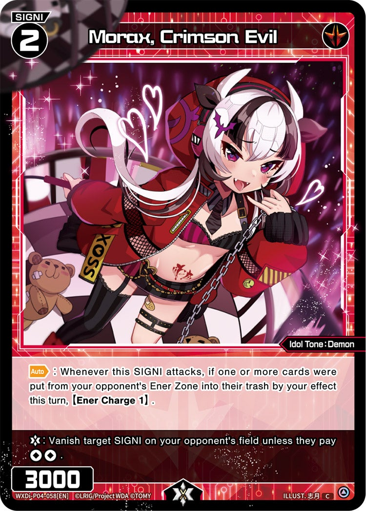

# Morax, Crimson Evil

## Thông tin lá

| Trường | Giá trị |
| --- | --- |
| Mã in | WXDi-P04-058[EN] |
| Set | WXDi-P04[EN] |
| Số thứ tự | 058 |
| Loại thẻ | SIGNI |
| Vị trí | Main Deck |
| Số bản | — (set booster, không áp dụng) |
| Màu | Đỏ |
| Độ hiếm | C,C(P) |
| Minh họa | 志月 |
| Level | 2 |
| Limit | — |
| Power | 3000 |
| LRIG type / Class | Idol Tone：Demon |
| Team / Master | — |
| Cost | — |
| Grow cost | — |
| Use timing | — |
| Life Burst | Có |

## Card text chính thức

[Auto]: Whenever this SIGNI attacks, if one or more cards were put from your opponent's Ener Zone into their trash by your effect this turn, 【Ener Charge 1】.

## Power text / Life Burst

Vanish target SIGNI on your opponent's field unless they pay {Colorless} {Colorless}.

## Ghi chú minh họa
Artist: 志月. Ảnh C được tải từ Card List tiếng Anh.

## FAQ chính thức

**Q. During my turn, "Morax, Crimson Evil" has been triggered the Life Burst by some effect. Then my opponent paid {Colorless} {Colorless}.
When another "Morax, Crimson Evil" attacks in same turn, may I 【Ener Charge 1】 by the [Auto] ability of another "Morax, Crimson Evil"?**
A. No, you cannot. Cards are moving from the Ener Zone to their Trash by the opponent paying cost. But paying cost is not meet the condition of [Auto] ability because the movement of the cards were not an effect but a payment of the cost.

## Ảnh biến thể

- [C(P)](../images/WXDi-P04-058P-EN.jpg)

## Nguồn
[Card List/FAQ chính thức](https://www.takaratomy.co.jp/products/en.wixoss/card/card.html?card_no=WXDi-P04-058%5BEN%5D ) · [Ảnh thẻ](https://www.takaratomy.co.jp/products/en.wixoss/card/thumb/WXDi-P04-058%5BEN%5D.jpg)
