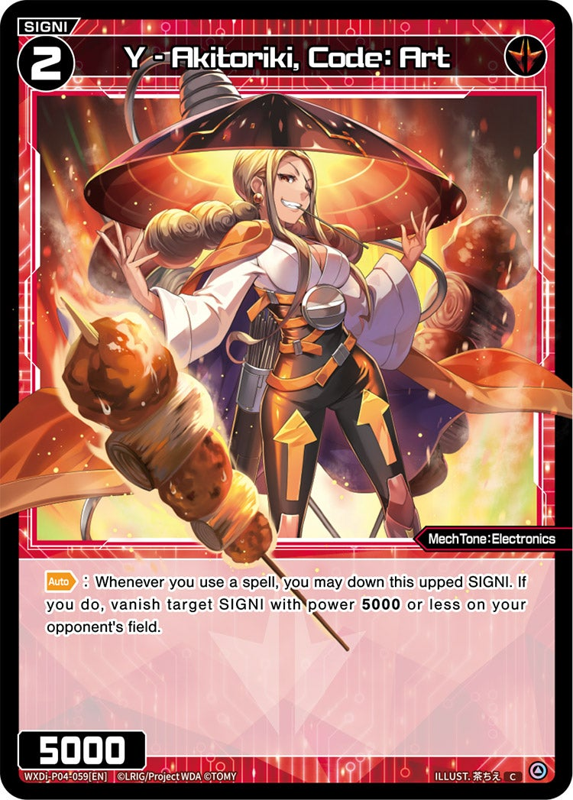

# Y - Akitoriki, Code: Art

## Thông tin lá

| Trường | Giá trị |
| --- | --- |
| Mã in | WXDi-P04-059[EN] |
| Set | WXDi-P04[EN] |
| Số thứ tự | 059 |
| Loại thẻ | SIGNI |
| Vị trí | Main Deck |
| Số bản | — (set booster, không áp dụng) |
| Màu | Đỏ |
| Độ hiếm | C,C(P) |
| Minh họa | 茶ちえ |
| Level | 2 |
| Limit | — |
| Power | 5000 |
| LRIG type / Class | Mech Tone：Electronics |
| Team / Master | — |
| Cost | — |
| Grow cost | — |
| Use timing | — |
| Life Burst | Không |

## Card text chính thức

[Auto]: Whenever you use a spell, you may down this upped SIGNI. If you do, vanish target SIGNI with power 5000 or less on your opponent's field.

## Power text / Life Burst

—

## Ghi chú minh họa
Artist: 茶ちえ. Ảnh C được tải từ Card List tiếng Anh.

## FAQ chính thức

**Q. This SINIG's [Auto] ability, and a Spell played. Which of [Auto] ability and a Spell played will be resolved first?**
A. A Spell played will be processed first. Decide the play of a spell triggers this SIGNI's [Auto] ability. Then you process the triggered [Auto] ability of this card.

**Q. Does this effect also vanish this downed SIGNI?**
A. No, only targeted opponent's SIGNI with 5000 or less power will be vanished.

## Ảnh biến thể

- [C(P)](../images/WXDi-P04-059P-EN.jpg)

## Nguồn
[Card List/FAQ chính thức](https://www.takaratomy.co.jp/products/en.wixoss/card/card.html?card_no=WXDi-P04-059%5BEN%5D ) · [Ảnh thẻ](https://www.takaratomy.co.jp/products/en.wixoss/card/thumb/WXDi-P04-059%5BEN%5D.jpg)
