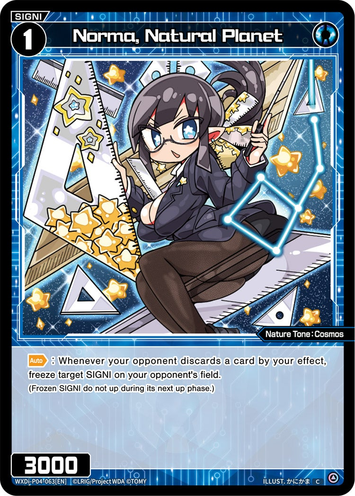

# Norma, Natural Planet

## Thông tin lá

| Trường | Giá trị |
| --- | --- |
| Mã in | WXDi-P04-063[EN] |
| Set | WXDi-P04[EN] |
| Số thứ tự | 063 |
| Loại thẻ | SIGNI |
| Vị trí | Main Deck |
| Số bản | — (set booster, không áp dụng) |
| Màu | Xanh dương |
| Độ hiếm | C,C(P) |
| Minh họa | かにかま |
| Level | 1 |
| Limit | — |
| Power | 3000 |
| LRIG type / Class | Nature Tone：Cosmos |
| Team / Master | — |
| Cost | — |
| Grow cost | — |
| Use timing | — |
| Life Burst | Không |

## Card text chính thức

[Auto]: Whenever your opponent discards a card by your effect, freeze target SIGNI on your opponent's field.
(Frozen SIGNI do not up during its next up phase.)

## Power text / Life Burst

—

## Ghi chú minh họa
Artist: かにかま. Ảnh C được tải từ Card List tiếng Anh.

## FAQ chính thức

**Q. When I played some effect of "your opponent discard two cards from your opponent's hand", does this [Auto] ability trigger?**
A. Yes, if your opponent discarded two cards, this [Auto] ability triggers twice.

## Ảnh biến thể

- [C(P)](../images/WXDi-P04-063P-EN.jpg)

## Nguồn
[Card List/FAQ chính thức](https://www.takaratomy.co.jp/products/en.wixoss/card/card.html?card_no=WXDi-P04-063%5BEN%5D ) · [Ảnh thẻ](https://www.takaratomy.co.jp/products/en.wixoss/card/thumb/WXDi-P04-063%5BEN%5D.jpg)
