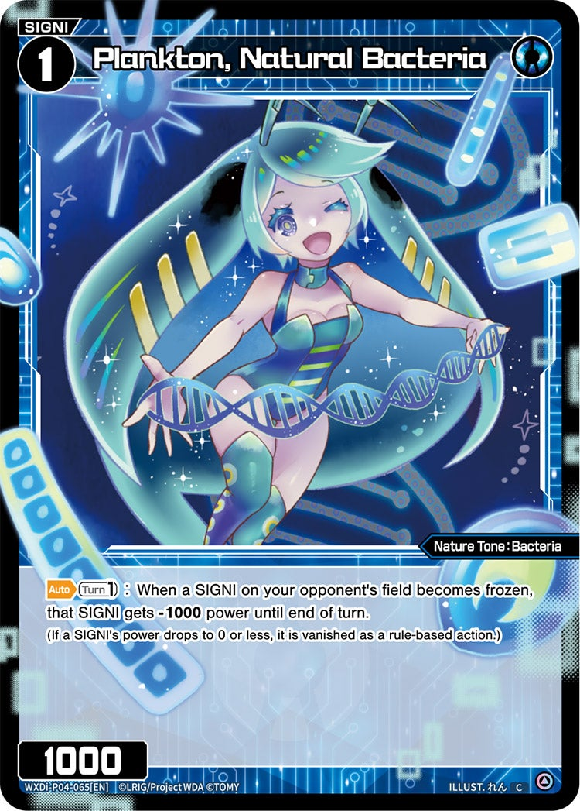

# Plankton, Natural Bacteria

## Thông tin lá

| Trường | Giá trị |
| --- | --- |
| Mã in | WXDi-P04-065[EN] |
| Set | WXDi-P04[EN] |
| Số thứ tự | 065 |
| Loại thẻ | SIGNI |
| Vị trí | Main Deck |
| Số bản | — (set booster, không áp dụng) |
| Màu | Xanh dương |
| Độ hiếm | C,C(P) |
| Minh họa | れん |
| Level | 1 |
| Limit | — |
| Power | 1000 |
| LRIG type / Class | Nature Tone：Bacteria |
| Team / Master | — |
| Cost | — |
| Grow cost | — |
| Use timing | — |
| Life Burst | Không |

## Card text chính thức

[Auto] {1/Turn}: When a SIGNI on your opponent's field becomes frozen, that SIGNI gets -1000 power until end of turn.
(If a SIGNI's power drops to 0 or less, it is vanished as a rule-based action.)

## Power text / Life Burst

—

## Ghi chú minh họa
Artist: れん. Ảnh C được tải từ Card List tiếng Anh.

## FAQ chính thức

**Q. If I play the effect of "freeze target SIGNI" to a frozen SIGNI, does this card's [Auto] ability trigger?**
A. No, this card's [Auto] ability triggers when freeze a non-frozen SIGNI.

**Q. When I frozen my opponent's SIGNI, then put "Plankton, Natural Bacteria" onto my field. And I freeze another my opponent's SIGNI. Does this card's [Auto] ability trigger?**
A. Yes, this [Auto] ability triggers when this SIGNI puts onto your field and your opponent's SIGNI freezes.

## Ảnh biến thể

- [C(P)](../images/WXDi-P04-065P-EN.jpg)

## Nguồn
[Card List/FAQ chính thức](https://www.takaratomy.co.jp/products/en.wixoss/card/card.html?card_no=WXDi-P04-065%5BEN%5D ) · [Ảnh thẻ](https://www.takaratomy.co.jp/products/en.wixoss/card/thumb/WXDi-P04-065%5BEN%5D.jpg)
