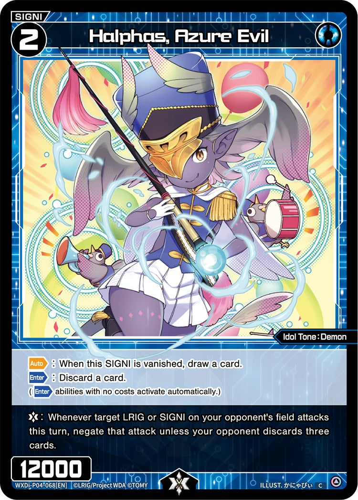

# Halphas, Azure Evil

## Thông tin lá

| Trường | Giá trị |
| --- | --- |
| Mã in | WXDi-P04-068[EN] |
| Set | WXDi-P04[EN] |
| Số thứ tự | 068 |
| Loại thẻ | SIGNI |
| Vị trí | Main Deck |
| Số bản | — (set booster, không áp dụng) |
| Màu | Xanh dương |
| Độ hiếm | C,C(P) |
| Minh họa | かにゃぴぃ |
| Level | 2 |
| Limit | — |
| Power | 12000 |
| LRIG type / Class | Idol Tone：Demon |
| Team / Master | — |
| Cost | — |
| Grow cost | — |
| Use timing | — |
| Life Burst | Có |

## Card text chính thức

[Auto]: When this SIGNI is vanished, draw a card.
[Enter]: Discard a card.
([Enter] abilities with no costs activate automatically.)

## Power text / Life Burst

Whenever target LRIG or SIGNI on your opponent's field attacks this turn, negate that attack unless your opponent discards three cards.

## Ghi chú minh họa
Artist: かにゃぴぃ. Ảnh C được tải từ Card List tiếng Anh.

## FAQ chính thức

**Q. If I have only this card in my hand, may I play this card from my hand?**
A. Yes, you may play this card from your hand. When this SIGNI triggered [Enter] ability, nothing happen if you not have any card in your hand. But this SIGNI remains on your field.

## Ảnh biến thể

- [C(P)](../images/WXDi-P04-068P-EN.jpg)

## Nguồn
[Card List/FAQ chính thức](https://www.takaratomy.co.jp/products/en.wixoss/card/card.html?card_no=WXDi-P04-068%5BEN%5D ) · [Ảnh thẻ](https://www.takaratomy.co.jp/products/en.wixoss/card/thumb/WXDi-P04-068%5BEN%5D.jpg)
