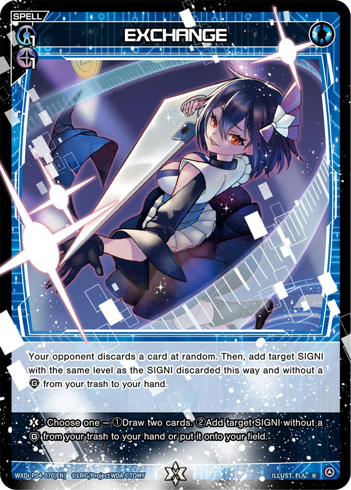

# EXCHANGE

## Thông tin lá

| Trường | Giá trị |
| --- | --- |
| Mã in | WXDi-P04-070[EN] |
| Set | WXDi-P04[EN] |
| Số thứ tự | 070 |
| Loại thẻ | SPELL |
| Vị trí | Main Deck |
| Số bản | — (set booster, không áp dụng) |
| Màu | Xanh dương |
| Độ hiếm | R,R(P) |
| Minh họa | れん |
| Level | — |
| Limit | — |
| Power | 0 |
| LRIG type / Class | — |
| Team / Master | — |
| Cost | 《U》×１ / 《B》×１ |
| Grow cost | — |
| Use timing | — |
| Life Burst | Có |

## Card text chính thức

Your opponent discards a card at random. Then, add target SIGNI with the same level as the SIGNI discarded this way and without a {Guard Icon} from your trash to your hand.

## Power text / Life Burst

Choose one — ①Draw two cards. ②Add target SIGNI without a {Guard Icon} from your trash to your hand or put it onto your field.

## Ghi chú minh họa
Artist: れん. Ảnh R được tải từ Card List tiếng Anh.

## FAQ chính thức

**Q. I played this Spell. Then my opponent discarded a Spell from my opponent's hand. May I add target SIGNI from my trash to my hand?**
A. No, if your opponent discarded a Spell, you cannot add a SIGNI from your trash to your hand.

## Ảnh biến thể

- [R(P)](../images/WXDi-P04-070P-EN.jpg)

## Nguồn
[Card List/FAQ chính thức](https://www.takaratomy.co.jp/products/en.wixoss/card/card.html?card_no=WXDi-P04-070%5BEN%5D ) · [Ảnh thẻ](https://www.takaratomy.co.jp/products/en.wixoss/card/thumb/WXDi-P04-070%5BEN%5D.jpg)
