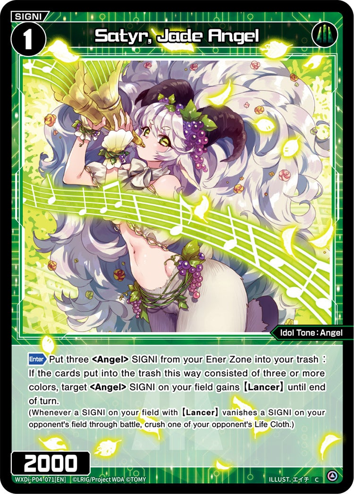

# Sátyros, Jade Angel

## Thông tin lá

| Trường | Giá trị |
| --- | --- |
| Mã in | WXDi-P04-071[EN] |
| Set | WXDi-P04[EN] |
| Số thứ tự | 071 |
| Loại thẻ | SIGNI |
| Vị trí | Main Deck |
| Số bản | — (set booster, không áp dụng) |
| Màu | Xanh lá |
| Độ hiếm | C,C(P) |
| Minh họa | エイチ |
| Level | 1 |
| Limit | — |
| Power | 2000 |
| LRIG type / Class | Idol Tone：Angel |
| Team / Master | — |
| Cost | — |
| Grow cost | — |
| Use timing | — |
| Life Burst | Không |

## Card text chính thức

[Enter] Put three <Angel> SIGNI from your Ener Zone into your trash: If the cards put into the trash this way consisted of three or more colors, target <Angel> SIGNI on your field gains 【Lancer】 until end of turn.
(Whenever a SIGNI on your field with 【Lancer】 vanishes a SIGNI on your opponent's field through battle, crush one of your opponent's Life Cloth.)

## Power text / Life Burst

—

## Ghi chú minh họa
Artist: エイチ. Ảnh C được tải từ Card List tiếng Anh.

## FAQ chính thức

**Q. Does this card's [Enter] ability must to be triggered?**
A. No, [Enter] Abilities that require cost can be triggered by paying cost when they enter the field. So you may also choose not to trigger it without paying the cost of [Enter] ability.

**Q. I want to increase the number of SIGNI with <Angel> in my trash, so may I pay the cost of [Enter] ability when three SIGNIs with <Angel> placed in my Ener Zone but they are not consisted three or more colors?**
A. Yes, the effect is nothing happens but you may pay that cost.

## Ảnh biến thể

- [C(P)](../images/WXDi-P04-071P-EN.jpg)

## Nguồn
[Card List/FAQ chính thức](https://www.takaratomy.co.jp/products/en.wixoss/card/card.html?card_no=WXDi-P04-071%5BEN%5D ) · [Ảnh thẻ](https://www.takaratomy.co.jp/products/en.wixoss/card/thumb/WXDi-P04-071%5BEN%5D.jpg)
