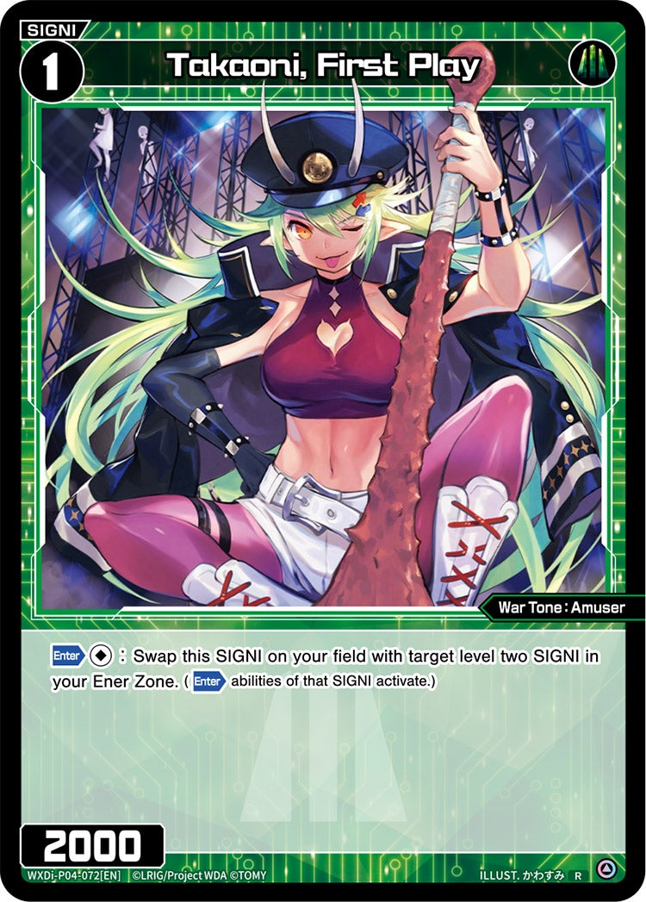

# Takaoni, First Play

## Thông tin lá

| Trường | Giá trị |
| --- | --- |
| Mã in | WXDi-P04-072[EN] |
| Set | WXDi-P04[EN] |
| Số thứ tự | 072 |
| Loại thẻ | SIGNI |
| Vị trí | Main Deck |
| Số bản | — (set booster, không áp dụng) |
| Màu | Xanh lá |
| Độ hiếm | R,R(P) |
| Minh họa | かわすみ |
| Level | 1 |
| Limit | — |
| Power | 2000 |
| LRIG type / Class | War Tone：Amuser |
| Team / Master | — |
| Cost | — |
| Grow cost | — |
| Use timing | — |
| Life Burst | Không |

## Card text chính thức

[Enter] {Colorless}: Swap this SIGNI on your field with target level two SIGNI in your Ener Zone. ([Enter] abilities of that SIGNI activate.)

## Power text / Life Burst

—

## Ghi chú minh họa
Artist: かわすみ. Ảnh R được tải từ Card List tiếng Anh.

## FAQ chính thức

**Q. When my center LRIG level is one, I put this card onto my field. May I play this card's [Enter] ability?**
A. You may declare play of this [Enter] ability and pay its cost. However a SIGNI with a level greater than the center LRIG level cannot be placed in your field. So you cannot swap a SIGNI. In the result nothing happen.

## Ảnh biến thể

- [R(P)](../images/WXDi-P04-072P-EN.jpg)

## Nguồn
[Card List/FAQ chính thức](https://www.takaratomy.co.jp/products/en.wixoss/card/card.html?card_no=WXDi-P04-072%5BEN%5D ) · [Ảnh thẻ](https://www.takaratomy.co.jp/products/en.wixoss/card/thumb/WXDi-P04-072%5BEN%5D.jpg)
