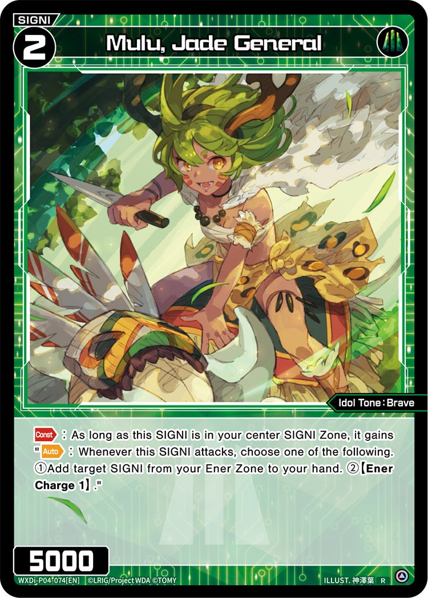

# Mulu, Jade General

## Thông tin lá

| Trường | Giá trị |
| --- | --- |
| Mã in | WXDi-P04-074[EN] |
| Set | WXDi-P04[EN] |
| Số thứ tự | 074 |
| Loại thẻ | SIGNI |
| Vị trí | Main Deck |
| Số bản | — (set booster, không áp dụng) |
| Màu | Xanh lá |
| Độ hiếm | R,R(P) |
| Minh họa | 神澤葉 |
| Level | 2 |
| Limit | — |
| Power | 5000 |
| LRIG type / Class | Idol Tone：Brave |
| Team / Master | — |
| Cost | — |
| Grow cost | — |
| Use timing | — |
| Life Burst | Không |

## Card text chính thức

[Constant]: As long as this SIGNI is in your center SIGNI Zone, it gains "[Auto]: Whenever this SIGNI attacks, choose one of the following. ①Add target SIGNI from your Ener Zone to your hand. ②【Ener Charge 1】."

## Power text / Life Burst

—

## Ghi chú minh họa
Artist: 神澤葉. Ảnh R được tải từ Card List tiếng Anh.

## FAQ chính thức

— (không có FAQ riêng cho mã này trên trang FAQ tiếng Anh.)

## Ảnh biến thể

- [R(P)](../images/WXDi-P04-074P-EN.jpg)

## Nguồn
[Card List/FAQ chính thức](https://www.takaratomy.co.jp/products/en.wixoss/card/card.html?card_no=WXDi-P04-074%5BEN%5D ) · [Ảnh thẻ](https://www.takaratomy.co.jp/products/en.wixoss/card/thumb/WXDi-P04-074%5BEN%5D.jpg)
