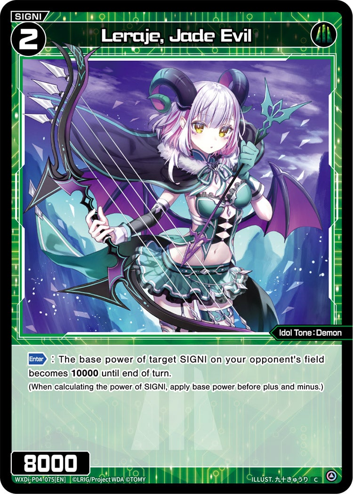

# Leraje, Jade Evil

## Thông tin lá

| Trường | Giá trị |
| --- | --- |
| Mã in | WXDi-P04-075[EN] |
| Set | WXDi-P04[EN] |
| Số thứ tự | 075 |
| Loại thẻ | SIGNI |
| Vị trí | Main Deck |
| Số bản | — (set booster, không áp dụng) |
| Màu | Xanh lá |
| Độ hiếm | C,C(P) |
| Minh họa | 九十きゅうり |
| Level | 2 |
| Limit | — |
| Power | 8000 |
| LRIG type / Class | Idol Tone：Demon |
| Team / Master | — |
| Cost | — |
| Grow cost | — |
| Use timing | — |
| Life Burst | Không |

## Card text chính thức

[Enter]: The base power of target SIGNI on your opponent's field becomes 10000 until end of turn.
(When calculating the power of SIGNI, apply base power before plus and minus.)

## Power text / Life Burst

—

## Ghi chú minh họa
Artist: 九十きゅうり. Ảnh C được tải từ Card List tiếng Anh.

## FAQ chính thức

**Q. My opponent's SIGNI with power 12000 got the effect of "target SIGNI gets -8000 power.". Then I put "Leraje, Jade Evil" in my field and the base power of my opponent's SIGNI became 10000 by [Enter] ability. What is the power of my opponent's SIGNI in the end?**
A. Your opponent's SIGNI became 10000 first, then it gets -8000. So it is power 2000 in the end.

## Ảnh biến thể

- [C(P)](../images/WXDi-P04-075P-EN.jpg)

## Nguồn
[Card List/FAQ chính thức](https://www.takaratomy.co.jp/products/en.wixoss/card/card.html?card_no=WXDi-P04-075%5BEN%5D ) · [Ảnh thẻ](https://www.takaratomy.co.jp/products/en.wixoss/card/thumb/WXDi-P04-075%5BEN%5D.jpg)
