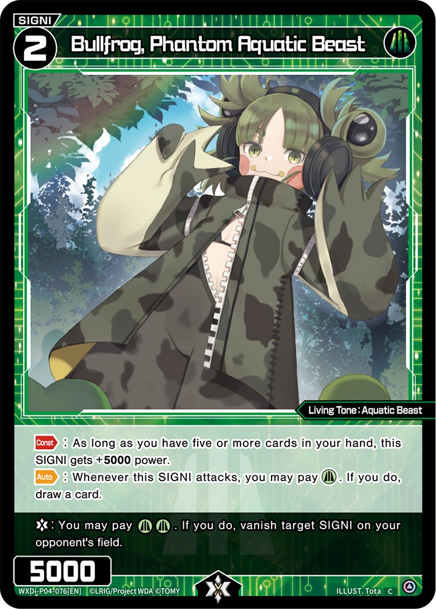

# Bullfrog, Phantom Aquatic Beast

## Thông tin lá

| Trường | Giá trị |
| --- | --- |
| Mã in | WXDi-P04-076[EN] |
| Set | WXDi-P04[EN] |
| Số thứ tự | 076 |
| Loại thẻ | SIGNI |
| Vị trí | Main Deck |
| Số bản | — (set booster, không áp dụng) |
| Màu | Xanh lá |
| Độ hiếm | C,C(P) |
| Minh họa | Tota |
| Level | 2 |
| Limit | — |
| Power | 5000 |
| LRIG type / Class | Living Tone：Aquatic Beast |
| Team / Master | — |
| Cost | — |
| Grow cost | — |
| Use timing | — |
| Life Burst | Có |

## Card text chính thức

[Constant]: As long as you have five or more cards in your hand, this SIGNI gets +5000 power.
[Auto]: Whenever this SIGNI attacks, you may pay {Green}. If you do, draw a card.

## Power text / Life Burst

You may pay {Green} {Green}. If you do, vanish target SIGNI on your opponent's field.

## Ghi chú minh họa
Artist: Tota. Ảnh C được tải từ Card List tiếng Anh.

## FAQ chính thức

**Q. When this SIGNI attacked, [Auto] ability was triggered and solved. As a result, I now have five cards in my hand. Does this card get +5000 power before the battle by its [Constant] ability?**
A. Yes, that SIGNI gets +5000 power. [Constant] ability is applied immediately if the conditions are met. In this case, "Bullfrog, Phantom Aquatic Beast" battles your opponent's SIGNI with power 10000. (If your opponent's SIGNI in front of Bullfrog, Phantom Aquatic Beast")

## Ảnh biến thể

- [C(P)](../images/WXDi-P04-076P-EN.jpg)

## Nguồn
[Card List/FAQ chính thức](https://www.takaratomy.co.jp/products/en.wixoss/card/card.html?card_no=WXDi-P04-076%5BEN%5D ) · [Ảnh thẻ](https://www.takaratomy.co.jp/products/en.wixoss/card/thumb/WXDi-P04-076%5BEN%5D.jpg)
