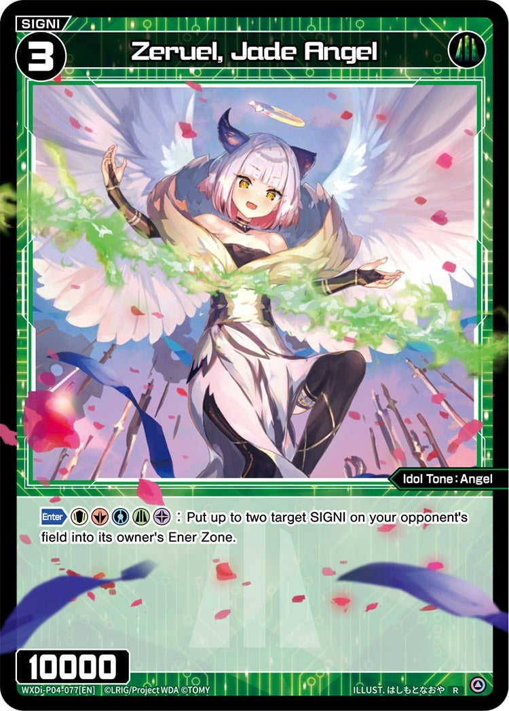

# Zeruel, Jade Angel

## Thông tin lá

| Trường | Giá trị |
| --- | --- |
| Mã in | WXDi-P04-077[EN] |
| Set | WXDi-P04[EN] |
| Số thứ tự | 077 |
| Loại thẻ | SIGNI |
| Vị trí | Main Deck |
| Số bản | — (set booster, không áp dụng) |
| Màu | Xanh lá |
| Độ hiếm | R,R(P) |
| Minh họa | はしもとなおや |
| Level | 3 |
| Limit | — |
| Power | 10000 |
| LRIG type / Class | Idol Tone：Angel |
| Team / Master | — |
| Cost | — |
| Grow cost | — |
| Use timing | — |
| Life Burst | Không |

## Card text chính thức

[Enter] {White} {Red} {Blue} {Green} {Black}: Put up to two target SIGNI on your opponent's field into its owner's Ener Zone.

## Power text / Life Burst

—

## Ghi chú minh họa
Artist: はしもとなおや. Ảnh R được tải từ Card List tiếng Anh.

## FAQ chính thức

**Q. May I put target SIGNI with "cannot be vanished" ability into its owner's Ener Zone by this [Enter] ability?**
A. Yes, you may put it. The effects of "cannot be vanished" and "put into owner's Ener Zone" are distinct, and the effect of "put into owner's Ener Zone" cannot be prevented by the ability of "cannot be vanished".

## Ảnh biến thể

- [R(P)](../images/WXDi-P04-077P-EN.jpg)

## Nguồn
[Card List/FAQ chính thức](https://www.takaratomy.co.jp/products/en.wixoss/card/card.html?card_no=WXDi-P04-077%5BEN%5D ) · [Ảnh thẻ](https://www.takaratomy.co.jp/products/en.wixoss/card/thumb/WXDi-P04-077%5BEN%5D.jpg)
