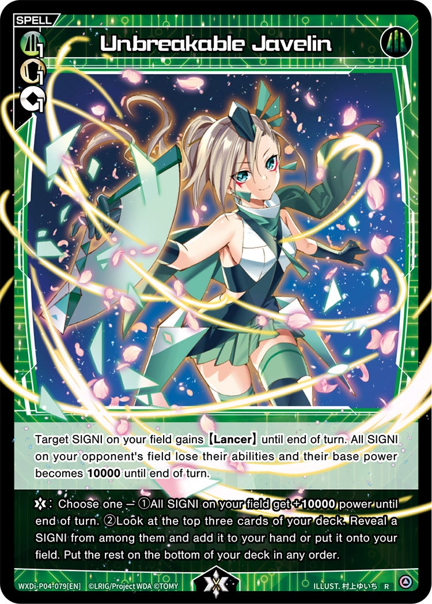

# Unbreakable Javelin

## Thông tin lá

| Trường | Giá trị |
| --- | --- |
| Mã in | WXDi-P04-079[EN] |
| Set | WXDi-P04[EN] |
| Số thứ tự | 079 |
| Loại thẻ | SPELL |
| Vị trí | Main Deck |
| Số bản | — (set booster, không áp dụng) |
| Màu | Xanh lá |
| Độ hiếm | R,R(P) |
| Minh họa | 村上ゆいち |
| Level | — |
| Limit | — |
| Power | 0 |
| LRIG type / Class | — |
| Team / Master | — |
| Cost | 《G》×１
《W》×１
《C》×１ |
| Grow cost | — |
| Use timing | — |
| Life Burst | Có |

## Card text chính thức

Target SIGNI on your field gains 【Lancer】 until end of turn. All SIGNI on your opponent's field lose their abilities and their base power becomes 10000 until end of turn.

## Power text / Life Burst

Choose one — ①All SIGNI on your field get +10000 power until end of turn. ②Look at the top three cards of your deck. Reveal a SIGNI from among them and add it to your hand or put it onto your field. Put the rest on the bottom of your deck in any order.

## Ghi chú minh họa
Artist: 村上ゆいち. Ảnh R được tải từ Card List tiếng Anh.

## FAQ chính thức

**Q. When I played this Spell this turn, my opponent's SIGNI lose all abilities and base its power becomes 10000 if your opponent put a SIGNI onto your opponent's field after this Spell played?**
A. No, that SIGNI will not lose abilities and became 10000. The effect of this Spell effects only SIGNIs on the opponent's field when this Spell is played.

## Ảnh biến thể

- [R(P)](../images/WXDi-P04-079P-EN.jpg)

## Nguồn
[Card List/FAQ chính thức](https://www.takaratomy.co.jp/products/en.wixoss/card/card.html?card_no=WXDi-P04-079%5BEN%5D ) · [Ảnh thẻ](https://www.takaratomy.co.jp/products/en.wixoss/card/thumb/WXDi-P04-079%5BEN%5D.jpg)
