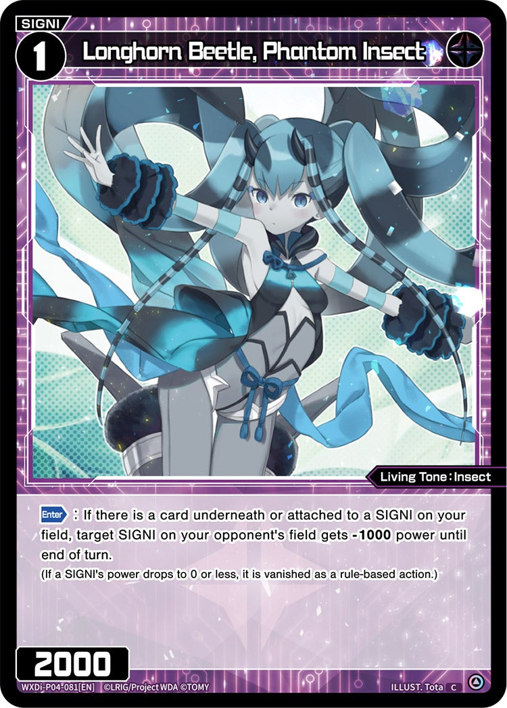

# Longhorn Beetle, Phantom Insect

## Thông tin lá

| Trường | Giá trị |
| --- | --- |
| Mã in | WXDi-P04-081[EN] |
| Set | WXDi-P04[EN] |
| Số thứ tự | 081 |
| Loại thẻ | SIGNI |
| Vị trí | Main Deck |
| Số bản | — (set booster, không áp dụng) |
| Màu | Đen |
| Độ hiếm | C,C(P) |
| Minh họa | Tota |
| Level | 1 |
| Limit | — |
| Power | 2000 |
| LRIG type / Class | Living Tone：Insect |
| Team / Master | — |
| Cost | — |
| Grow cost | — |
| Use timing | — |
| Life Burst | Không |

## Card text chính thức

[Enter]: If there is a card underneath or attached to a SIGNI on your field, target SIGNI on your opponent's field gets -1000 power until end of turn.
(If a SIGNI's power drops to 0 or less, it is vanished as a rule-based action.)

## Power text / Life Burst

—

## Ghi chú minh họa
Artist: Tota. Ảnh C được tải từ Card List tiếng Anh.

## FAQ chính thức

**Q. There is a face-down "Parthenos, Code: Ancients" in my SIGNI Zone. If I put this card in that zone, does my opponent's SIGNI get -1000 power by the effect of [Enter] ability?**
A. No, card that is placed face down in the SIGNI Zone, even if they are physically placed under a SIGNI, are not treated as "card underneath to a SIGNI". "card underneath to a SIGNI" means, for example to card placed underneath by 【Rise】 and a card placed under the effect of "put a card under a SIGNI".

## Ảnh biến thể

- [C(P)](../images/WXDi-P04-081P-EN.jpg)

## Nguồn
[Card List/FAQ chính thức](https://www.takaratomy.co.jp/products/en.wixoss/card/card.html?card_no=WXDi-P04-081%5BEN%5D ) · [Ảnh thẻ](https://www.takaratomy.co.jp/products/en.wixoss/card/thumb/WXDi-P04-081%5BEN%5D.jpg)
