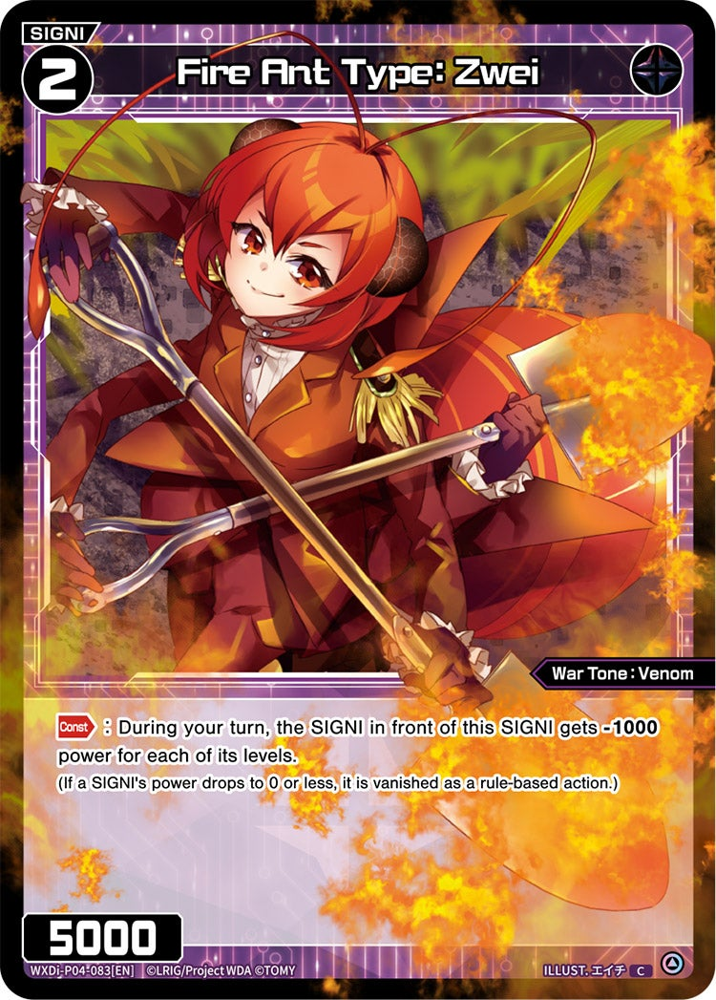

# Fire Ant Type: Zwei

## Thông tin lá

| Trường | Giá trị |
| --- | --- |
| Mã in | WXDi-P04-083[EN] |
| Set | WXDi-P04[EN] |
| Số thứ tự | 083 |
| Loại thẻ | SIGNI |
| Vị trí | Main Deck |
| Số bản | — (set booster, không áp dụng) |
| Màu | Đen |
| Độ hiếm | C,C(P) |
| Minh họa | エイチ |
| Level | 2 |
| Limit | — |
| Power | 5000 |
| LRIG type / Class | War Tone：Venom |
| Team / Master | — |
| Cost | — |
| Grow cost | — |
| Use timing | — |
| Life Burst | Không |

## Card text chính thức

[Constant]: During your turn, the SIGNI in front of this SIGNI gets -1000 power for each of its levels.
(If a SIGNI's power drops to 0 or less, it is vanished as a rule-based action.)

## Power text / Life Burst

—

## Ghi chú minh họa
Artist: エイチ. Ảnh C được tải từ Card List tiếng Anh.

## FAQ chính thức

**Q. My opponent puts a level one SIGNI of power 1000 with [Enter] ability in front of "Fire Ant Type: Zwei". Does [Enter] ability of your opponent's SIGNI trigger?**
A. Yes, [Enter] ability of your opponent's SIGNI is triggered, and that SIGNI is vanished by Rule-based action. Then, resolve triggered [Enter] ability of your opponent's SIGNI.

## Ảnh biến thể

- [C(P)](../images/WXDi-P04-083P-EN.jpg)

## Nguồn
[Card List/FAQ chính thức](https://www.takaratomy.co.jp/products/en.wixoss/card/card.html?card_no=WXDi-P04-083%5BEN%5D ) · [Ảnh thẻ](https://www.takaratomy.co.jp/products/en.wixoss/card/thumb/WXDi-P04-083%5BEN%5D.jpg)
