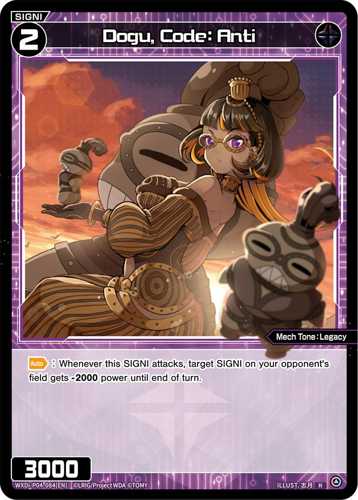

# Dogu, Code: Anti

## Thông tin lá

| Trường | Giá trị |
| --- | --- |
| Mã in | WXDi-P04-084[EN] |
| Set | WXDi-P04[EN] |
| Số thứ tự | 084 |
| Loại thẻ | SIGNI |
| Vị trí | Main Deck |
| Số bản | — (set booster, không áp dụng) |
| Màu | Đen |
| Độ hiếm | R,R(P) |
| Minh họa | 志月 |
| Level | 2 |
| Limit | — |
| Power | 3000 |
| LRIG type / Class | Mech Tone：Legacy |
| Team / Master | — |
| Cost | — |
| Grow cost | — |
| Use timing | — |
| Life Burst | Không |

## Card text chính thức

[Auto]: Whenever this SIGNI attacks, target SIGNI on your opponent's field gets -2000 power until end of turn.

## Power text / Life Burst

—

## Ghi chú minh họa
Artist: 志月. Ảnh R được tải từ Card List tiếng Anh.

## FAQ chính thức

**Q. When this SIGNI attacked, [Auto] ability was triggered and target SIGNI in front of this SIGNI. Then, target SIGNI vanished because it became less than power 0. What happens to battle of this SIGNI at this point?**
A. If target SINIG leaves the field after the [Auto] ability that triggers when that SIGNI attacked, that SIGNI deal damage to your opponent because there is no SIGNI in front of it at the time the attack itself is processed.

## Ảnh biến thể

- [R(P)](../images/WXDi-P04-084P-EN.jpg)

## Nguồn
[Card List/FAQ chính thức](https://www.takaratomy.co.jp/products/en.wixoss/card/card.html?card_no=WXDi-P04-084%5BEN%5D ) · [Ảnh thẻ](https://www.takaratomy.co.jp/products/en.wixoss/card/thumb/WXDi-P04-084%5BEN%5D.jpg)
