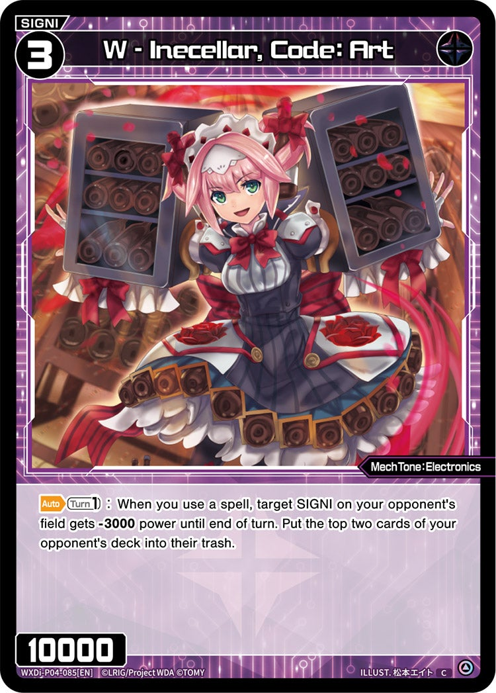

# W - Inecellar, Code: Art

## Thông tin lá

| Trường | Giá trị |
| --- | --- |
| Mã in | WXDi-P04-085[EN] |
| Set | WXDi-P04[EN] |
| Số thứ tự | 085 |
| Loại thẻ | SIGNI |
| Vị trí | Main Deck |
| Số bản | — (set booster, không áp dụng) |
| Màu | Đen |
| Độ hiếm | C,C(P) |
| Minh họa | 松本エイト |
| Level | 3 |
| Limit | — |
| Power | 10000 |
| LRIG type / Class | Mech Tone：Electronics |
| Team / Master | — |
| Cost | — |
| Grow cost | — |
| Use timing | — |
| Life Burst | Không |

## Card text chính thức

[Auto] {1/Turn}: When you use a spell, target SIGNI on your opponent's field gets -3000 power until end of turn. Put the top two cards of your opponent's deck into their trash.

## Power text / Life Burst

—

## Ghi chú minh họa
Artist: 松本エイト. Ảnh C được tải từ Card List tiếng Anh.

## FAQ chính thức

**Q. This SINIG's [Auto] ability, and a Spell played. Which of [Auto] ability and a Spell played will be resolved first?**
A. A Spell played will be processed first. Decide the play of a spell triggers this SIGNI's [Auto] ability. Then you process the triggered [Auto] ability of this card.

## Ảnh biến thể

- [C(P)](../images/WXDi-P04-085P-EN.jpg)

## Nguồn
[Card List/FAQ chính thức](https://www.takaratomy.co.jp/products/en.wixoss/card/card.html?card_no=WXDi-P04-085%5BEN%5D ) · [Ảnh thẻ](https://www.takaratomy.co.jp/products/en.wixoss/card/thumb/WXDi-P04-085%5BEN%5D.jpg)
