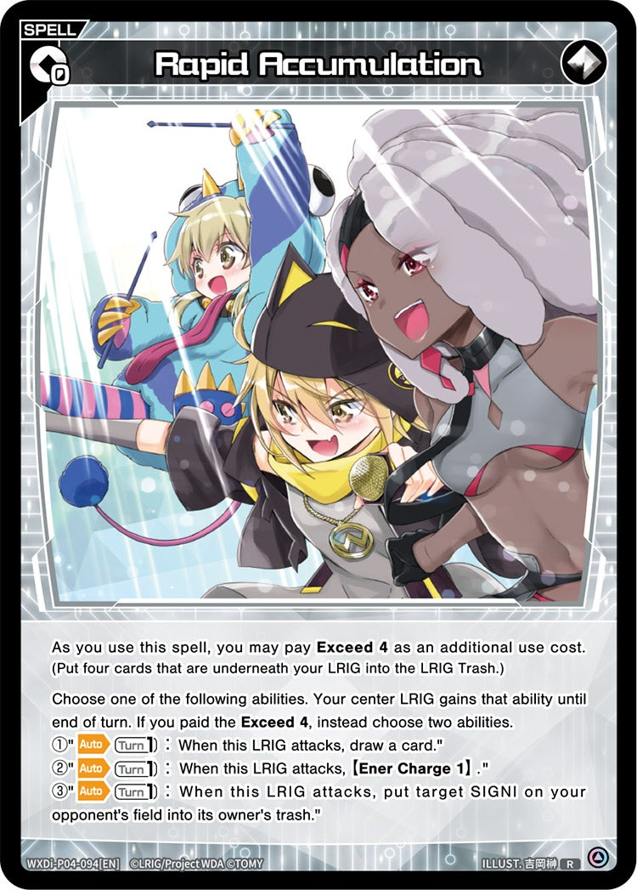

# Rapid Accumulation

## Thông tin lá

| Trường | Giá trị |
| --- | --- |
| Mã in | WXDi-P04-094[EN] |
| Set | WXDi-P04[EN] |
| Số thứ tự | 094 |
| Loại thẻ | SPELL |
| Vị trí | Main Deck |
| Số bản | — (set booster, không áp dụng) |
| Màu | Không màu |
| Độ hiếm | R,R(P) |
| Minh họa | 吉岡榊 |
| Level | — |
| Limit | — |
| Power | 0 |
| LRIG type / Class | — |
| Team / Master | — |
| Cost | 《C》×０ |
| Grow cost | — |
| Use timing | — |
| Life Burst | Không |

## Card text chính thức

As you use this spell, you may pay Exceed 4 as an additional use cost. (Put four cards that are underneath your LRIG into the LRIG Trash.)

Choose one of the following abilities. Your center LRIG gains that ability until end of turn. If you paid the Exceed 4, instead choose two abilities.
①"[Auto] {1/Turn}: When this LRIG attacks, draw a card."
②"[Auto] {1/Turn}: When this LRIG attacks, 【Ener Charge 1】."
③"[Auto] {1/Turn}: When this LRIG attacks, put target SIGNI on your opponent's field into its owner's trash."

## Power text / Life Burst

—

## Ghi chú minh họa
Artist: 吉岡榊. Ảnh R được tải từ Card List tiếng Anh.

## FAQ chính thức

— (không có FAQ riêng cho mã này trên trang FAQ tiếng Anh.)

## Ảnh biến thể

- [R(P)](../images/WXDi-P04-094P-EN.jpg)

## Nguồn
[Card List/FAQ chính thức](https://www.takaratomy.co.jp/products/en.wixoss/card/card.html?card_no=WXDi-P04-094%5BEN%5D ) · [Ảnh thẻ](https://www.takaratomy.co.jp/products/en.wixoss/card/thumb/WXDi-P04-094%5BEN%5D.jpg)
