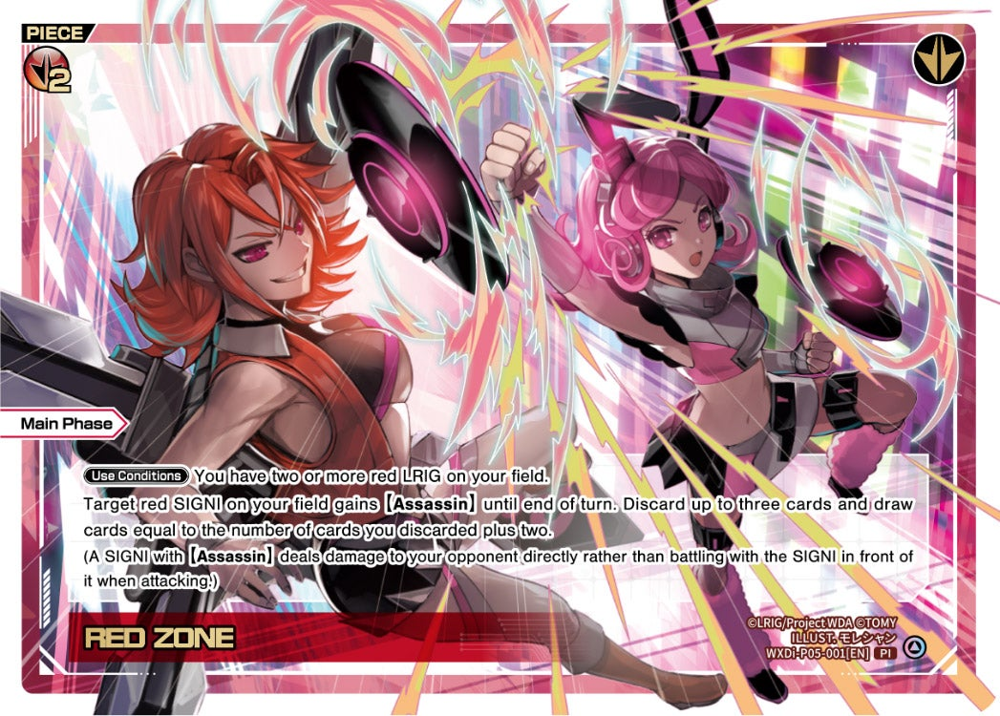

# RED ZONE

## Thông tin lá

| Trường | Giá trị |
| --- | --- |
| Mã in | WXDi-P05-001[EN] |
| Set | WXDi-P05[EN] |
| Số thứ tự | 001 |
| Loại thẻ | PIECE |
| Vị trí | LRIG Deck |
| Số bản | — (set booster, không áp dụng) |
| Màu | Đỏ |
| Độ hiếm | PI |
| Minh họa | モレシャン |
| Level | — |
| Limit | — |
| Power | 0 |
| LRIG type / Class | — |
| Team / Master | — |
| Cost | 《R》×２ |
| Grow cost | — |
| Use timing | Main Phase |
| Life Burst | Không |

## Card text chính thức

[Use Conditions] You have two or more red LRIG on your field.

Target red SIGNI on your field gains 【Assassin】 until end of turn. Discard up to three cards and draw cards equal to the number of cards you discarded plus two.
(A SIGNI with 【Assassin】 deals damage to your opponent directly rather than battling with the SIGNI in front of it when attacking.)

## Power text / Life Burst

—

## Ghi chú minh họa
Artist: モレシャン. Ảnh PI được tải từ Card List tiếng Anh.

## FAQ chính thức

**Q. If I play this card when there is no SIGNI on my field, may I draw cards?**
A. Yes, you can drow cards even if you cannot target your SIGNI.

**Q. May I draw two cards without discarding my hand with this effect?**
A. Yes, you can choose to discard zero cards and draw zero plus two cards.

## Nguồn
[Card List/FAQ chính thức](https://www.takaratomy.co.jp/products/en.wixoss/card/card.html?card_no=WXDi-P05-001%5BEN%5D ) · [Ảnh thẻ](https://www.takaratomy.co.jp/products/en.wixoss/card/thumb/WXDi-P05-001%5BEN%5D.jpg)
