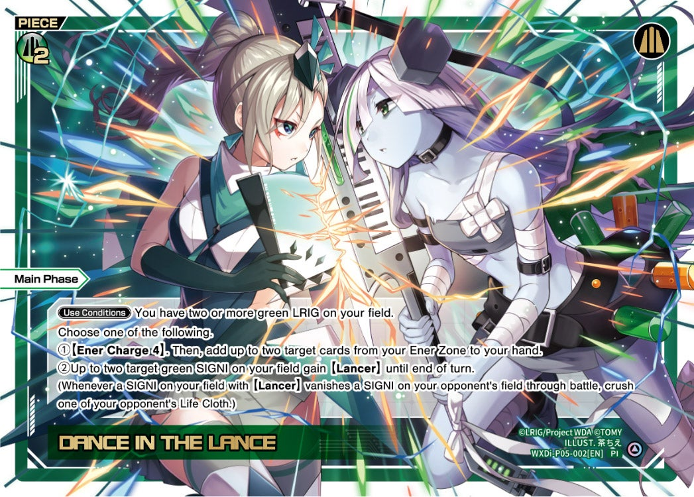

# DANCE IN THE LANCE

## Thông tin lá

| Trường | Giá trị |
| --- | --- |
| Mã in | WXDi-P05-002[EN] |
| Set | WXDi-P05[EN] |
| Số thứ tự | 002 |
| Loại thẻ | PIECE |
| Vị trí | LRIG Deck |
| Số bản | — (set booster, không áp dụng) |
| Màu | Xanh lá |
| Độ hiếm | PI |
| Minh họa | 茶ちえ |
| Level | — |
| Limit | — |
| Power | 0 |
| LRIG type / Class | — |
| Team / Master | — |
| Cost | 《G》×２ |
| Grow cost | — |
| Use timing | Main Phase |
| Life Burst | Không |

## Card text chính thức

[Use Conditions] You have two or more green LRIG on your field.

Choose one of the following.
①【Ener Charge 4】. Then, add up to two target cards from your Ener Zone to your hand.
②Up to two target green SIGNI on your field gain 【Lancer】 until end of turn.
(Whenever a SIGNI on your field with 【Lancer】 vanishes a SIGNI on your opponent's field through battle, crush one of your opponent's Life Cloth.)

## Power text / Life Burst

—

## Ghi chú minh họa
Artist: 茶ちえ. Ảnh PI được tải từ Card List tiếng Anh.

## FAQ chính thức

**Q. After processing 【Ener Charge 4】 with this card's effect of ①, may I choose not to add any cards from Ener Zone to my hand?**
A. Yes, you can. If you target "up to" some number of cards, you may target none.

## Nguồn
[Card List/FAQ chính thức](https://www.takaratomy.co.jp/products/en.wixoss/card/card.html?card_no=WXDi-P05-002%5BEN%5D ) · [Ảnh thẻ](https://www.takaratomy.co.jp/products/en.wixoss/card/thumb/WXDi-P05-002%5BEN%5D.jpg)
