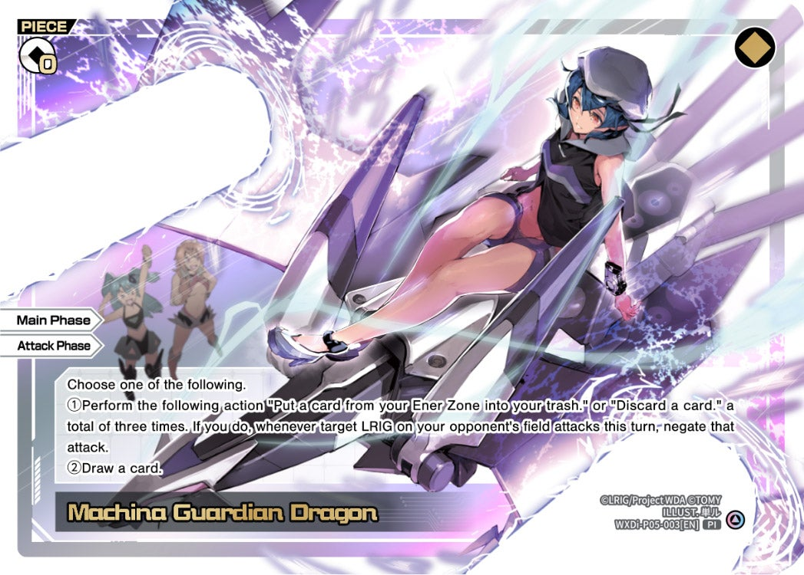

# Machina Guardian Dragon

## Thông tin lá

| Trường | Giá trị |
| --- | --- |
| Mã in | WXDi-P05-003[EN] |
| Set | WXDi-P05[EN] |
| Số thứ tự | 003 |
| Loại thẻ | PIECE |
| Vị trí | LRIG Deck |
| Số bản | — (set booster, không áp dụng) |
| Màu | Không màu |
| Độ hiếm | PI |
| Minh họa | 単ル |
| Level | — |
| Limit | — |
| Power | 0 |
| LRIG type / Class | — |
| Team / Master | — |
| Cost | 《C》×０ |
| Grow cost | — |
| Use timing | Main Phase / Attack Phase |
| Life Burst | Không |

## Card text chính thức

Choose one of the following.
①Perform the following action "Put a card from your Ener Zone into your trash." or "Discard a card." a total of three times. If you do, whenever target LRIG on your opponent's field attacks this turn, negate that attack.
②Draw a card.

## Power text / Life Burst

—

## Ghi chú minh họa
Artist: 単ル. Ảnh PI được tải từ Card List tiếng Anh.

## FAQ chính thức

**Q. When I have no cards in my hand, I played this card and chosen the effect of ①.
May I perform the "Discard a card" action a total of three times and negate target LRIG attack?**
A. No, you cannot perform "Discard a card", so you cannot process text after of "If you do" and nagate target LRIG attack.

## Nguồn
[Card List/FAQ chính thức](https://www.takaratomy.co.jp/products/en.wixoss/card/card.html?card_no=WXDi-P05-003%5BEN%5D ) · [Ảnh thẻ](https://www.takaratomy.co.jp/products/en.wixoss/card/thumb/WXDi-P05-003%5BEN%5D.jpg)
