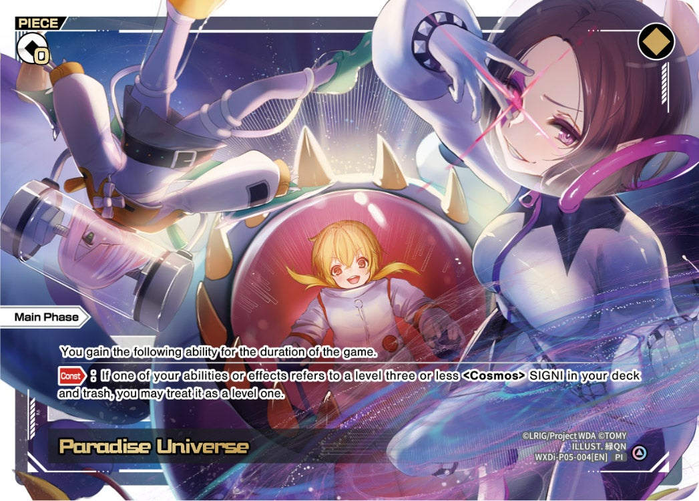

# Paradise Universe

## Thông tin lá

| Trường | Giá trị |
| --- | --- |
| Mã in | WXDi-P05-004[EN] |
| Set | WXDi-P05[EN] |
| Số thứ tự | 004 |
| Loại thẻ | PIECE |
| Vị trí | LRIG Deck |
| Số bản | — (set booster, không áp dụng) |
| Màu | Không màu |
| Độ hiếm | PI |
| Minh họa | 緑QN |
| Level | — |
| Limit | — |
| Power | 0 |
| LRIG type / Class | — |
| Team / Master | — |
| Cost | 《C》×０ |
| Grow cost | — |
| Use timing | Main Phase |
| Life Burst | Không |

## Card text chính thức

You gain the following ability for the duration of the game.
『[Constant]: If one of your abilities or effects refers to a level three or less <Cosmos> SIGNI in your deck and trash, you may treat it as a level one.』

## Power text / Life Burst

—

## Ghi chú minh họa
Artist: 緑QN. Ảnh PI được tải từ Card List tiếng Anh.

## FAQ chính thức

**Q. What exactly will happen if I play this PIECE?**
A. For example, 《Casseopeia, Natural Planet Queen》 has the automatic ability "Whenever this SIGNI attacks, reveal the top four cards of your deck. If there are three or more level one SIGNI among them". If you reveal the top four cards of your deck by its effect, level three and level two <Cosmos> SIGNIs can also be treated as level one SIGNIs.

## Nguồn
[Card List/FAQ chính thức](https://www.takaratomy.co.jp/products/en.wixoss/card/card.html?card_no=WXDi-P05-004%5BEN%5D ) · [Ảnh thẻ](https://www.takaratomy.co.jp/products/en.wixoss/card/thumb/WXDi-P05-004%5BEN%5D.jpg)
