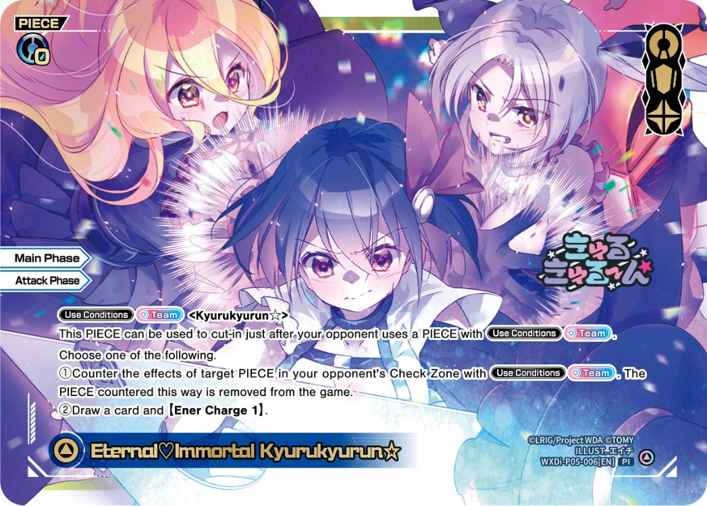

# Eternal♡Immortal Kyurukyurun☆

## Thông tin lá

| Trường | Giá trị |
| --- | --- |
| Mã in | WXDi-P05-006[EN] |
| Set | WXDi-P05[EN] |
| Số thứ tự | 006 |
| Loại thẻ | PIECE |
| Vị trí | LRIG Deck |
| Số bản | — (set booster, không áp dụng) |
| Màu | Xanh dương / trắng / đen |
| Độ hiếm | PI,DiR |
| Minh họa | エイチ |
| Level | — |
| Limit | — |
| Power | 0 |
| LRIG type / Class | — |
| Team / Master | — |
| Cost | 《U》×０ |
| Grow cost | — |
| Use timing | Main Phase / Attack Phase |
| Life Burst | Không |

## Card text chính thức

[Use Conditions] [Team] <Kyurukyurun☆>
This PIECE can be used to cut-in just after your opponent uses a PIECE with [Use Conditions] [Team].

Choose one of the following.
①Counter the effects of target PIECE in your opponent's Check Zone with [Use Conditions] [Team]. The PIECE countered this way is removed from the game.
②Draw a card and 【Ener Charge 1】.

## Power text / Life Burst

—

## Ghi chú minh họa
Artist: エイチ. Ảnh PI được tải từ Card List tiếng Anh.

## FAQ chính thức

**Q. What happens if the effect of target PIECE is countered?**
A. Nothing happens to the effect of countered target PIECE. And target PIECE is removed from the game by this card's effect. If target PIECE has paid the Ener cost to play, it remains paid.

**Q. When my opponent play a PIECE with [Use Conditions] [Team], I played this card to cut-in just after it. May I choose this card's effect of ②?**
A. Yes, if you played to cut-in just after your opponent played a PIECE, you can choose this card's effect of ②.

## Ảnh biến thể

- [DiR](../images/WXDi-P05-006D-EN.jpg)

## Nguồn
[Card List/FAQ chính thức](https://www.takaratomy.co.jp/products/en.wixoss/card/card.html?card_no=WXDi-P05-006%5BEN%5D ) · [Ảnh thẻ](https://www.takaratomy.co.jp/products/en.wixoss/card/thumb/WXDi-P05-006%5BEN%5D.jpg)
