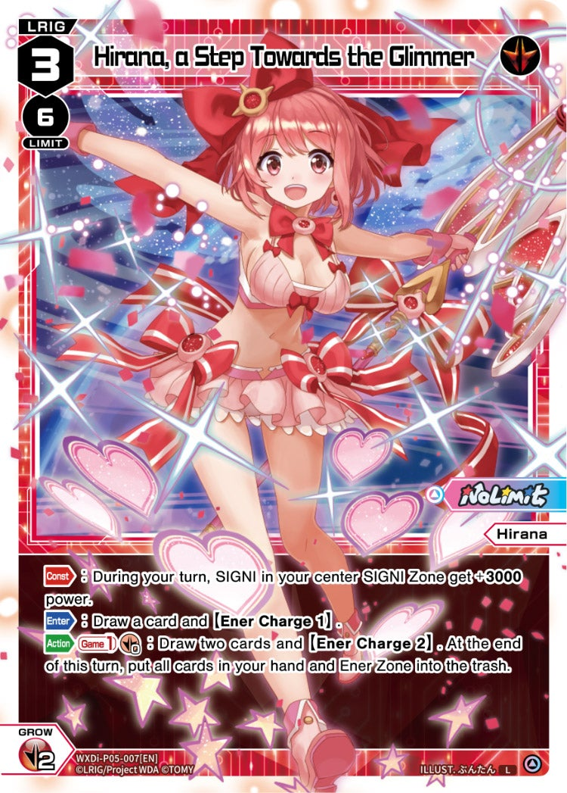

# Hirana, a Step Towards the Glimmer

## Thông tin lá

| Trường | Giá trị |
| --- | --- |
| Mã in | WXDi-P05-007[EN] |
| Set | WXDi-P05[EN] |
| Số thứ tự | 007 |
| Loại thẻ | LRIG |
| Vị trí | LRIG Deck |
| Số bản | — (set booster, không áp dụng) |
| Màu | Đỏ |
| Độ hiếm | L,SCR,DiR |
| Minh họa | ぶんたん |
| Level | 3 |
| Limit | 6 |
| Power | 0 |
| LRIG type / Class | Hirana |
| Team / Master | No Limit |
| Cost | — |
| Grow cost | 《R》×２ |
| Use timing | — |
| Life Burst | Không |

## Card text chính thức

[Constant]: During your turn, SIGNI in your center SIGNI Zone get +3000 power.
[Enter]: Draw a card and 【Ener Charge 1】.
[Action] {1/Game} {Redx0}: Draw two cards and 【Ener Charge 2】. At the end of this turn, put all cards in your hand and Ener Zone into the trash.

## Power text / Life Burst

—

## Ghi chú minh họa
Artist: ぶんたん. Ảnh L được tải từ Card List tiếng Anh.

## FAQ chính thức

**Q. I played the [Action] ability when I have two cards in my deck. What happens?**
A. The effects are processed in order from the top of card text, so you draw those two cards. And you cannot 【Ener Charge 2】. Then you refresh your deck because your deck has no cards.

## Ảnh biến thể

- [DiR](../images/WXDi-P05-007D-EN.jpg)
- [SCR](../images/WXDi-P05-007S-EN.jpg)

## Nguồn
[Card List/FAQ chính thức](https://www.takaratomy.co.jp/products/en.wixoss/card/card.html?card_no=WXDi-P05-007%5BEN%5D ) · [Ảnh thẻ](https://www.takaratomy.co.jp/products/en.wixoss/card/thumb/WXDi-P05-007%5BEN%5D.jpg)
