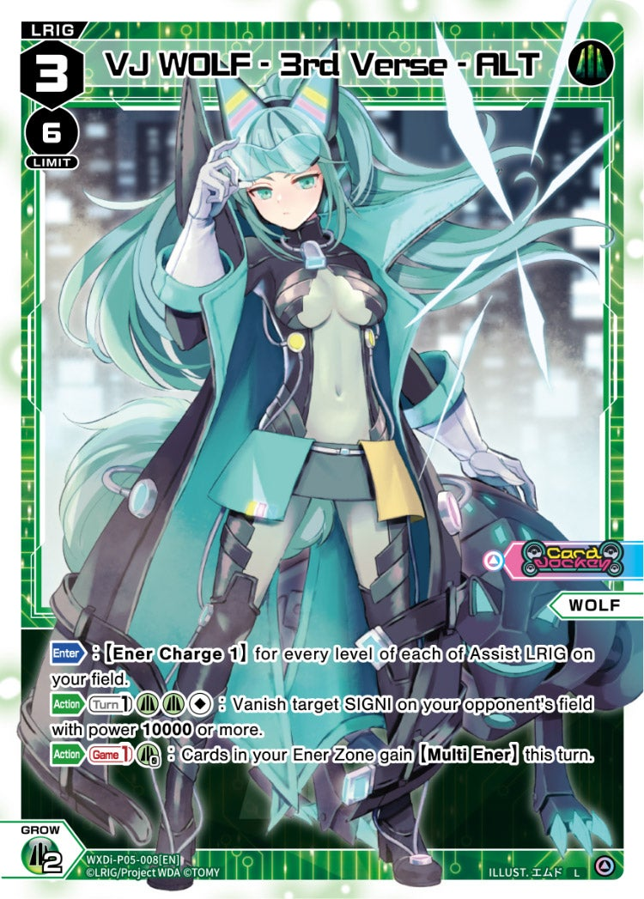

# VJ WOLF - 3rd Verse - ALT

## Thông tin lá

| Trường | Giá trị |
| --- | --- |
| Mã in | WXDi-P05-008[EN] |
| Set | WXDi-P05[EN] |
| Số thứ tự | 008 |
| Loại thẻ | LRIG |
| Vị trí | LRIG Deck |
| Số bản | — (set booster, không áp dụng) |
| Màu | Xanh lá |
| Độ hiếm | L,SCR,DiR |
| Minh họa | エムド |
| Level | 3 |
| Limit | 6 |
| Power | 0 |
| LRIG type / Class | WOLF |
| Team / Master | Card Jockey |
| Cost | — |
| Grow cost | 《G》×２ |
| Use timing | — |
| Life Burst | Không |

## Card text chính thức

[Enter]: 【Ener Charge 1】 for every level of each of Assist LRIG on your field.
[Action] {1/Turn} {Green} {Green} {Colorless}: Vanish target SIGNI on your opponent's field with power 10000 or more.
[Action] {1/Game} {Greenx0}: Cards in your Ener Zone gain 【Multi Ener】 this turn.

## Power text / Life Burst

—

## Ghi chú minh họa
Artist: エムド. Ảnh L được tải từ Card List tiếng Anh.

## FAQ chính thức

**Q. Does cards put to my Ener Zone after playing the [Action] of the third ability gain 【Multi Ener】?**
A. Yes, cards put to your Ener Zone after playing the [Action] of the third ability gain 【Multi Ener】 this turn.

## Ảnh biến thể

- [DiR](../images/WXDi-P05-008D-EN.jpg)
- [SCR](../images/WXDi-P05-008S-EN.jpg)

## Nguồn
[Card List/FAQ chính thức](https://www.takaratomy.co.jp/products/en.wixoss/card/card.html?card_no=WXDi-P05-008%5BEN%5D ) · [Ảnh thẻ](https://www.takaratomy.co.jp/products/en.wixoss/card/thumb/WXDi-P05-008%5BEN%5D.jpg)
