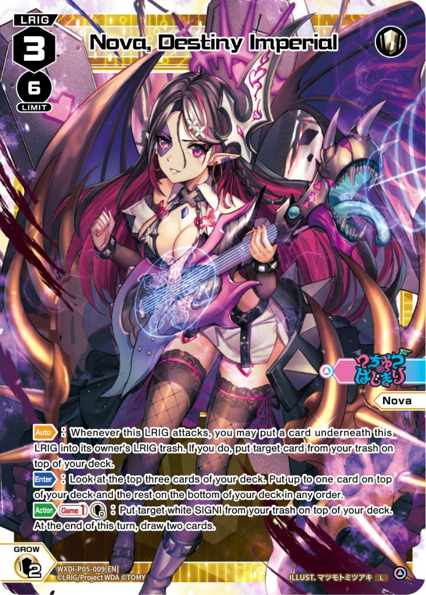

# Nova, Destiny Imperial

## Thông tin lá

| Trường | Giá trị |
| --- | --- |
| Mã in | WXDi-P05-009[EN] |
| Set | WXDi-P05[EN] |
| Số thứ tự | 009 |
| Loại thẻ | LRIG |
| Vị trí | LRIG Deck |
| Số bản | — (set booster, không áp dụng) |
| Màu | Trắng |
| Độ hiếm | L,SCR,DiR |
| Minh họa | マツモトミツアキ |
| Level | 3 |
| Limit | 6 |
| Power | 0 |
| LRIG type / Class | Nova |
| Team / Master | UCHU NO HAJIMARI |
| Cost | — |
| Grow cost | 《W》×２ |
| Use timing | — |
| Life Burst | Không |

## Card text chính thức

[Auto]: Whenever this LRIG attacks, you may put a card underneath this LRIG into its owner's LRIG trash. If you do, put target card from your trash on top of your deck.
[Enter]: Look at the top three cards of your deck. Put up to one card on top of your deck and the rest on the bottom of your deck in any order.
[Action] {1/Game} {Whitex0}: Put target white SIGNI from your trash on top of your deck. At the end of this turn, draw two cards.

## Power text / Life Burst

—

## Ghi chú minh họa
Artist: マツモトミツアキ. Ảnh L được tải từ Card List tiếng Anh.

## FAQ chính thức

**Q. Which card is put on the top of my deck by [Auto] ability?**
A. Put target card from your trash.

**Q. I played this card's [Action] ability, then I drew two cards at the end of this turn and now I have seven cards in my hand. Do I need choose and discard a card until I have six?**
A. Yes, you must choose and discard a card until you have six. In the end phase, the effect that triggers "at the end of turn" is first triggered, so you draw two cards. Then the effect of "until end of this turn" ends, and if you have seven or more cards in your hand, you choose and discard cards until you have six.

**Q. May I play this card's [Action] ability and draw cards even if cards have no white SIGNIs in my trash?**
A. Yes, this ability doesn't write "if you do" so you draw two cards at the end of the turn regardless of whether you put a white SIGNI on the top of your deck or not.

## Ảnh biến thể

- [DiR](../images/WXDi-P05-009D-EN.jpg)
- [SCR](../images/WXDi-P05-009S-EN.jpg)

## Nguồn
[Card List/FAQ chính thức](https://www.takaratomy.co.jp/products/en.wixoss/card/card.html?card_no=WXDi-P05-009%5BEN%5D ) · [Ảnh thẻ](https://www.takaratomy.co.jp/products/en.wixoss/card/thumb/WXDi-P05-009%5BEN%5D.jpg)
