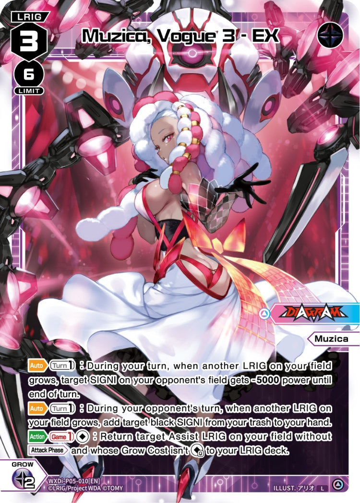

# Muzica, Vogue 3 - EX

## Thông tin lá

| Trường | Giá trị |
| --- | --- |
| Mã in | WXDi-P05-010[EN] |
| Set | WXDi-P05[EN] |
| Số thứ tự | 010 |
| Loại thẻ | LRIG |
| Vị trí | LRIG Deck |
| Số bản | — (set booster, không áp dụng) |
| Màu | Đen |
| Độ hiếm | L,SCR,DiR |
| Minh họa | アリオ |
| Level | 3 |
| Limit | 6 |
| Power | 0 |
| LRIG type / Class | Muzica |
| Team / Master | DIAGRAM |
| Cost | — |
| Grow cost | 《B》×２ |
| Use timing | — |
| Life Burst | Không |

## Card text chính thức

[Auto] {1/Turn}: During your turn, when another LRIG on your field grows, target SIGNI on your opponent's field gets -5000 power until end of turn.
[Auto] {1/Turn}: During your opponent's turn, when another LRIG on your field grows, add target black SIGNI from your trash to your hand.
[Action] {1/Game} {Colorless}: Return target Assist LRIG on your field without {Attack Phase Icon} and whose Grow Cost isn't {Colorlessx0} to your LRIG deck.

## Power text / Life Burst

—

## Ghi chú minh họa
Artist: アリオ. Ảnh L được tải từ Card List tiếng Anh.

## FAQ chính thức

**Q. Do this card's [Auto] abilities also trigger when my Assist LRIG grows?**
A. Yes, this card's [Auto] abilities also trigger when my Assist LRIG grows.

**Q. When my Assist LRIG grows, if is has an [Enter] ability, which triggers first, its [Enter] ability or this card's [Auto] ability?**
A. Both are triggered when your Assist LRIG grows, so they can be triggered in your any order.

**Q. What happens if this card return an Assist LRIG to my LRIG deck with its [Action] ability?**
A. The targeted Assist LRIG is returned to your LRIG deck, and the Assist LRIG was underneath it remains on the field as an Assist LRIG. If you return an Assist LRIG that has no card underneath it, such as by paying the Exceed cost, the Assist LRIG is no longer there and cannot be newly put an Assist LRIG on it during the game.

## Ảnh biến thể

- [DiR](../images/WXDi-P05-010D-EN.jpg)
- [SCR](../images/WXDi-P05-010S-EN.jpg)

## Nguồn
[Card List/FAQ chính thức](https://www.takaratomy.co.jp/products/en.wixoss/card/card.html?card_no=WXDi-P05-010%5BEN%5D ) · [Ảnh thẻ](https://www.takaratomy.co.jp/products/en.wixoss/card/thumb/WXDi-P05-010%5BEN%5D.jpg)
