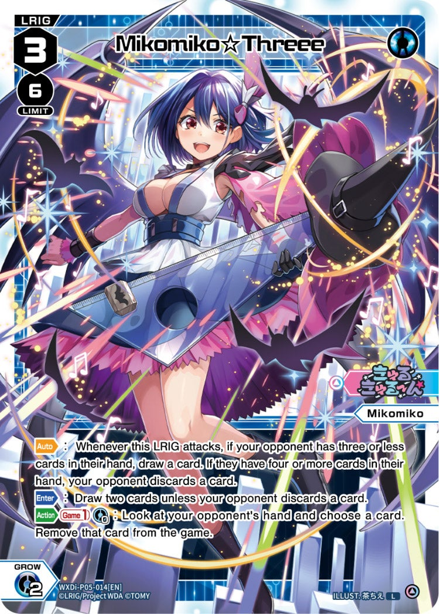

# Mikomiko☆Threee

## Thông tin lá

| Trường | Giá trị |
| --- | --- |
| Mã in | WXDi-P05-014[EN] |
| Set | WXDi-P05[EN] |
| Số thứ tự | 014 |
| Loại thẻ | LRIG |
| Vị trí | LRIG Deck |
| Số bản | — (set booster, không áp dụng) |
| Màu | Xanh dương |
| Độ hiếm | L,SCR,DiR |
| Minh họa | 茶ちえ |
| Level | 3 |
| Limit | 6 |
| Power | 0 |
| LRIG type / Class | Mikomiko |
| Team / Master | Kyurukyurun☆ |
| Cost | — |
| Grow cost | 《U》×２ |
| Use timing | — |
| Life Burst | Không |

## Card text chính thức

[Auto]: Whenever this LRIG attacks, if your opponent has three or less cards in their hand, draw a card. If they have four or more cards in their hand, your opponent discards a card.
[Enter]: Draw two cards unless your opponent discards a card.
[Action] {1/Game} {Bluex0}: Look at your opponent's hand and choose a card. Remove that card from the game.

## Power text / Life Burst

—

## Ghi chú minh họa
Artist: 茶ちえ. Ảnh L được tải từ Card List tiếng Anh.

## FAQ chính thức

**Q. Which player draws a card by this card's [Auto] ability?**
A. The player who controls the attacking 《Mikomiko☆Threee》 draws a card.

**Q. Which player chooses whether or not to discard a card in my opponent's hand by this card's [Enter] ability?**
A. The opponent of the player controlling 《Mikomiko☆Threee》 chooses whether or not to discard a card, and if that player does not discard, the player controlling 《Mikomiko☆Threee》 draws two cards.

**Q. Can my opponent choose to discard a card if my opponent has zero cards in my opponent's hand when this card's [Enter] ability was triggered?**
A. No, your opponent cannot. In that case, your opponent has not discard a card in your opponent's hand, so you draw two cards.

## Ảnh biến thể

- [DiR](../images/WXDi-P05-014D-EN.jpg)
- [SCR](../images/WXDi-P05-014S-EN.jpg)

## Nguồn
[Card List/FAQ chính thức](https://www.takaratomy.co.jp/products/en.wixoss/card/card.html?card_no=WXDi-P05-014%5BEN%5D ) · [Ảnh thẻ](https://www.takaratomy.co.jp/products/en.wixoss/card/thumb/WXDi-P05-014%5BEN%5D.jpg)
