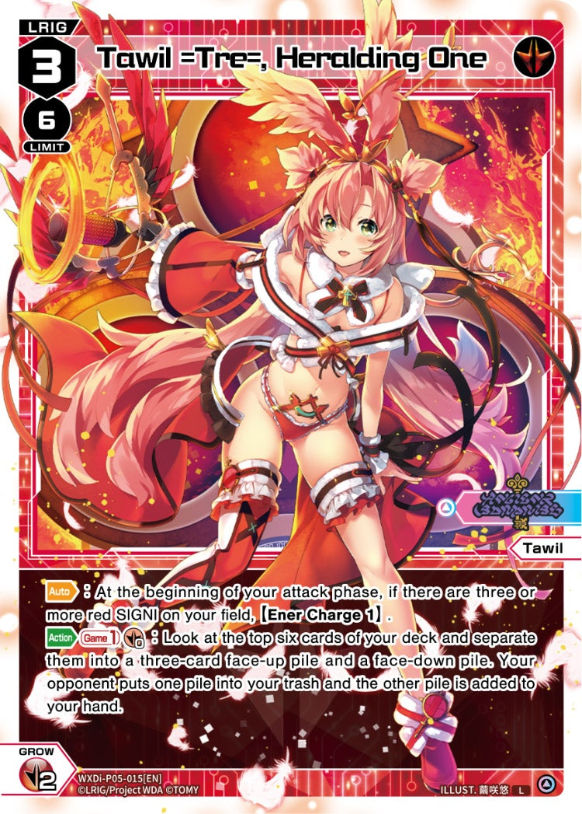

# Tawil =Tre=, Heralding One

## Thông tin lá

| Trường | Giá trị |
| --- | --- |
| Mã in | WXDi-P05-015[EN] |
| Set | WXDi-P05[EN] |
| Số thứ tự | 015 |
| Loại thẻ | LRIG |
| Vị trí | LRIG Deck |
| Số bản | — (set booster, không áp dụng) |
| Màu | Đỏ |
| Độ hiếm | L,SCR,DiR |
| Minh họa | 繭咲悠 |
| Level | 3 |
| Limit | 6 |
| Power | 0 |
| LRIG type / Class | Tawil |
| Team / Master | Ancient Surprise |
| Cost | — |
| Grow cost | 《R》×２ |
| Use timing | — |
| Life Burst | Không |

## Card text chính thức

[Auto]: At the beginning of your attack phase, if there are three or more red SIGNI on your field, 【Ener Charge 1】.
[Action] {1/Game} {Redx0}: Look at the top six cards of your deck and separate them into a three-card face-up pile and a face-down pile. Your opponent puts one pile into your trash and the other pile is added to your hand.

## Power text / Life Burst

—

## Ghi chú minh họa
Artist: 繭咲悠. Ảnh L được tải từ Card List tiếng Anh.

## FAQ chính thức

**Q. What happens if my deck is three cards or less when I played this card's [Action] ability?**
A. In that case, your deck with three or less cards will be a face-up pile. Your opponent chooses to process with either a face-up pile of three or fewer cards or a face-down pile of zero cards. You then refresh your deck, since you have zero cards in it.

## Ảnh biến thể

- [DiR](../images/WXDi-P05-015D-EN.jpg)
- [SCR](../images/WXDi-P05-015S-EN.jpg)

## Nguồn
[Card List/FAQ chính thức](https://www.takaratomy.co.jp/products/en.wixoss/card/card.html?card_no=WXDi-P05-015%5BEN%5D ) · [Ảnh thẻ](https://www.takaratomy.co.jp/products/en.wixoss/card/thumb/WXDi-P05-015%5BEN%5D.jpg)
