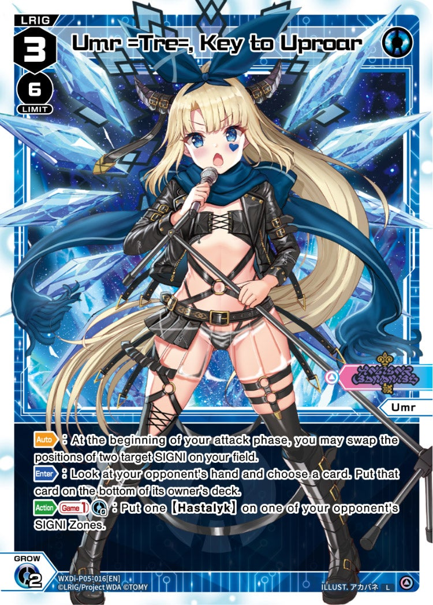

# Umr =Tre=, Key to Uproar

## Thông tin lá

| Trường | Giá trị |
| --- | --- |
| Mã in | WXDi-P05-016[EN] |
| Set | WXDi-P05[EN] |
| Số thứ tự | 016 |
| Loại thẻ | LRIG |
| Vị trí | LRIG Deck |
| Số bản | — (set booster, không áp dụng) |
| Màu | Xanh dương |
| Độ hiếm | L,SCR,DiR |
| Minh họa | アカバネ |
| Level | 3 |
| Limit | 6 |
| Power | 0 |
| LRIG type / Class | Umr |
| Team / Master | Ancient Surprise |
| Cost | — |
| Grow cost | 《U》×２ |
| Use timing | — |
| Life Burst | Không |

## Card text chính thức

[Auto]: At the beginning of your attack phase, you may swap the positions of two target SIGNI on your field.
[Enter]: Look at your opponent's hand and choose a card. Put that card on the bottom of its owner's deck.
[Action] {1/Game} {Bluex0}: Put one 【Hastalyk】 on one of your opponent's SIGNI Zones.

## Power text / Life Burst

—

## Ghi chú minh họa
Artist: アカバネ. Ảnh L được tải từ Card List tiếng Anh.

## FAQ chính thức

**Q. May I move only one of my SIGNI on the field in only one of my SINIG is on the field by this card's [Auto] ability?**
A. No, since this ability is "target two SIGNIs" nothing will happen if you not target two SIGNIs.

**Q. What is 【Hastalyk】?**
A. Please refer to the individual FAQ of 【Hastalyk】.

**Q. May I put 【Hastalyk】 on a SIGNI Zone that already has a SIGNI or other cards on it?**
A. Yes, you can. It doesn't matter what is placed in a SIGNI Zone when put [Hastalik] by this card's [Action] ability.

## Ảnh biến thể

- [DiR](../images/WXDi-P05-016D-EN.jpg)
- [SCR](../images/WXDi-P05-016S-EN.jpg)

## Nguồn
[Card List/FAQ chính thức](https://www.takaratomy.co.jp/products/en.wixoss/card/card.html?card_no=WXDi-P05-016%5BEN%5D ) · [Ảnh thẻ](https://www.takaratomy.co.jp/products/en.wixoss/card/thumb/WXDi-P05-016%5BEN%5D.jpg)
