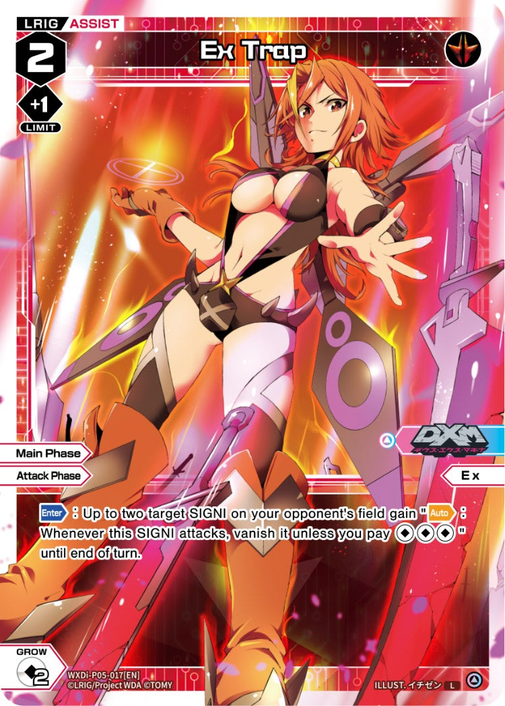

# Ex Trap

## Thông tin lá

| Trường | Giá trị |
| --- | --- |
| Mã in | WXDi-P05-017[EN] |
| Set | WXDi-P05[EN] |
| Số thứ tự | 017 |
| Loại thẻ | ASSIST LRIG |
| Vị trí | LRIG Deck |
| Số bản | — (set booster, không áp dụng) |
| Màu | Đỏ |
| Độ hiếm | L,L(P) |
| Minh họa | イチゼン |
| Level | 2 |
| Limit | ＋1 |
| Power | 0 |
| LRIG type / Class | Ex |
| Team / Master | DEUS・EX・MACHINA |
| Cost | — |
| Grow cost | 《C》×２ |
| Use timing | Main Phase
Attack Phase |
| Life Burst | Không |

## Card text chính thức

[Enter]: Up to two target SIGNI on your opponent's field gain "[Auto]: Whenever this SIGNI attacks, vanish it unless you pay {Colorless} {Colorless} {Colorless}" until end of turn.

## Power text / Life Burst

—

## Ghi chú minh họa
Artist: イチゼン. Ảnh L được tải từ Card List tiếng Anh.

## FAQ chính thức

**Q. Which [Auto] ability is triggered first, the [Auto] ability given to the targeted SIGNI by this card's [Enter] ability or the [Auto] ability "Whenever this SIGNI attacks" of the SIGNI itself?**
A. Both are abilities of that SIGNI, so they can be triggered in your any order.

## Ảnh biến thể

- [L(P)](../images/WXDi-P05-017P-EN.jpg)

## Nguồn
[Card List/FAQ chính thức](https://www.takaratomy.co.jp/products/en.wixoss/card/card.html?card_no=WXDi-P05-017%5BEN%5D ) · [Ảnh thẻ](https://www.takaratomy.co.jp/products/en.wixoss/card/thumb/WXDi-P05-017%5BEN%5D.jpg)
