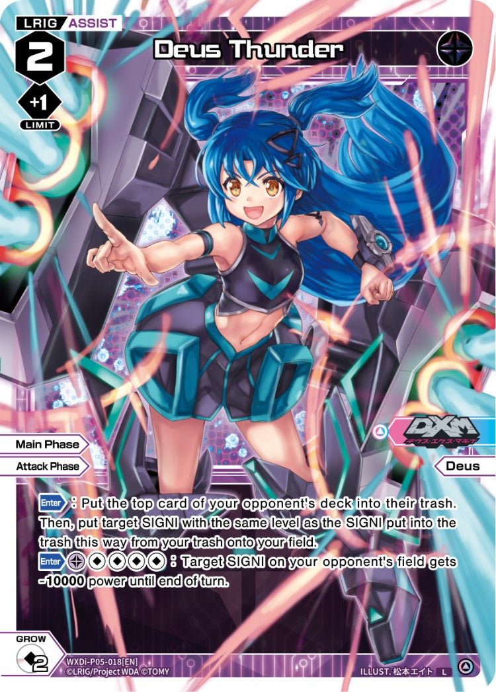

# Deus Thunder

## Thông tin lá

| Trường | Giá trị |
| --- | --- |
| Mã in | WXDi-P05-018[EN] |
| Set | WXDi-P05[EN] |
| Số thứ tự | 018 |
| Loại thẻ | ASSIST LRIG |
| Vị trí | LRIG Deck |
| Số bản | — (set booster, không áp dụng) |
| Màu | Đen |
| Độ hiếm | L,L(P) |
| Minh họa | 松本エイト |
| Level | 2 |
| Limit | ＋1 |
| Power | 0 |
| LRIG type / Class | Deus |
| Team / Master | DEUS・EX・MACHINA |
| Cost | — |
| Grow cost | 《C》×２ |
| Use timing | Main Phase / Attack Phase |
| Life Burst | Không |

## Card text chính thức

[Enter]: Put the top card of your opponent's deck into their trash. Then, put target SIGNI with the same level as the SIGNI put into the trash this way from your trash onto your field.
[Enter] {Black} {Colorless} {Colorless} {Colorless} {Colorless}: Target SIGNI on your opponent's field gets -10000 power until end of turn.

## Power text / Life Burst

—

## Ghi chú minh họa
Artist: 松本エイト. Ảnh L được tải từ Card List tiếng Anh.

## FAQ chính thức

**Q. What happens if a spell is put into your opponent's trash from the top of their deck by the first [Enter] ability?**
A. In that case, you cannot target a SIGNI in your trash because there is no SIGNIs put into your opponent's trash by this way.

## Ảnh biến thể

- [L(P)](../images/WXDi-P05-018P-EN.jpg)

## Nguồn
[Card List/FAQ chính thức](https://www.takaratomy.co.jp/products/en.wixoss/card/card.html?card_no=WXDi-P05-018%5BEN%5D ) · [Ảnh thẻ](https://www.takaratomy.co.jp/products/en.wixoss/card/thumb/WXDi-P05-018%5BEN%5D.jpg)
