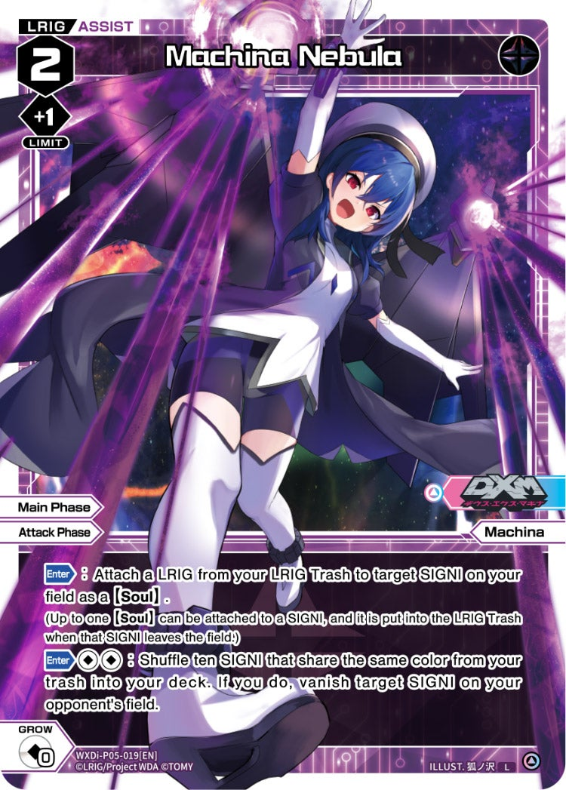

# Machina Nebula

## Thông tin lá

| Trường | Giá trị |
| --- | --- |
| Mã in | WXDi-P05-019[EN] |
| Set | WXDi-P05[EN] |
| Số thứ tự | 019 |
| Loại thẻ | ASSIST LRIG |
| Vị trí | LRIG Deck |
| Số bản | — (set booster, không áp dụng) |
| Màu | Đen |
| Độ hiếm | L,L(P) |
| Minh họa | 狐ノ沢 |
| Level | 2 |
| Limit | ＋1 |
| Power | 0 |
| LRIG type / Class | Machina |
| Team / Master | DEUS・EX・MACHINA |
| Cost | — |
| Grow cost | 《C》×０ |
| Use timing | Main Phase / Attack Phase |
| Life Burst | Không |

## Card text chính thức

[Enter]: Attach a LRIG from your LRIG Trash to target SIGNI on your field as a 【Soul】.
(Up to one 【Soul】 can be attached to a SIGNI, and it is put into the LRIG Trash when that SIGNI leaves the field.)
[Enter] {Colorless} {Colorless}: Shuffle ten SIGNI that share the same color from your trash into your deck. If you do, vanish target SIGNI on your opponent's field.

## Power text / Life Burst

—

## Ghi chú minh họa
Artist: 狐ノ沢. Ảnh L được tải từ Card List tiếng Anh.

## FAQ chính thức

**Q. What is 【Soul】?**
A. LRIG may be attached to SIGNI as 【Soul】 by effect. You cannot attach more than two 【Soul】 on a SIGNI. If the SIGNI with a 【Soul】 attached to it leaves the field, 【Soul】 will be put into its owner's LRIG trash by Rule-based action.

## Ảnh biến thể

- [L(P)](../images/WXDi-P05-019P-EN.jpg)

## Nguồn
[Card List/FAQ chính thức](https://www.takaratomy.co.jp/products/en.wixoss/card/card.html?card_no=WXDi-P05-019%5BEN%5D ) · [Ảnh thẻ](https://www.takaratomy.co.jp/products/en.wixoss/card/thumb/WXDi-P05-019%5BEN%5D.jpg)
