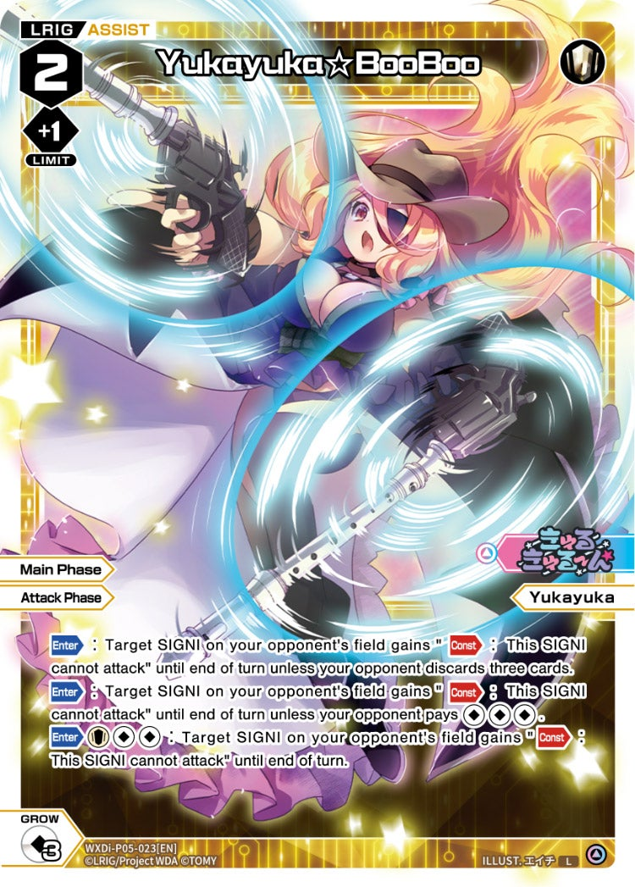

# Yukayuka☆BooBoo

## Thông tin lá

| Trường | Giá trị |
| --- | --- |
| Mã in | WXDi-P05-023[EN] |
| Set | WXDi-P05[EN] |
| Số thứ tự | 023 |
| Loại thẻ | ASSIST LRIG |
| Vị trí | LRIG Deck |
| Số bản | — (set booster, không áp dụng) |
| Màu | Trắng |
| Độ hiếm | L,L(P) |
| Minh họa | エイチ |
| Level | 2 |
| Limit | ＋1 |
| Power | 0 |
| LRIG type / Class | Yukayuka |
| Team / Master | Kyurukyurun☆ |
| Cost | — |
| Grow cost | 《C》×３ |
| Use timing | Main Phase / Attack Phase |
| Life Burst | Không |

## Card text chính thức

[Enter]: Target SIGNI on your opponent's field gains "[Constant]: This SIGNI cannot attack" until end of turn unless your opponent discards three cards.
[Enter]: Target SIGNI on your opponent's field gains "[Constant]: This SIGNI cannot attack" until end of turn unless your opponent pays {Colorless} {Colorless} {Colorless}.
[Enter] {White} {Colorless} {Colorless}: Target SIGNI on your opponent's field gains "[Constant]: This SIGNI cannot attack" until end of turn.

## Power text / Life Burst

—

## Ghi chú minh họa
Artist: エイチ. Ảnh L được tải từ Card List tiếng Anh.

## FAQ chính thức

**Q. At what timing does my opponent discard three cards or pay {Colorless} {Colorless} {Colorless} for the first or second [Enter] ability?**
A. [Enter] abilities have triggered and is in the process of resolving. They are not at the time when SIGNIs attack.

**Q. When do the three [Enter] abilities target SIGNI?**
A. This is the time when the [Enter] abilities are triggered. For example, if you trigger the first [Enter] ability first and your opponent discards three cards from your opponent's hand, you can then trigger the second [Enter] ability and target the same SIGNI.

## Ảnh biến thể

- [L(P)](../images/WXDi-P05-023P-EN.jpg)

## Nguồn
[Card List/FAQ chính thức](https://www.takaratomy.co.jp/products/en.wixoss/card/card.html?card_no=WXDi-P05-023%5BEN%5D ) · [Ảnh thẻ](https://www.takaratomy.co.jp/products/en.wixoss/card/thumb/WXDi-P05-023%5BEN%5D.jpg)
