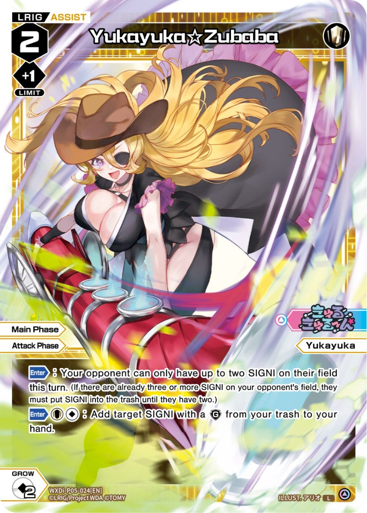

# Yukayuka☆Zubaba

## Thông tin lá

| Trường | Giá trị |
| --- | --- |
| Mã in | WXDi-P05-024[EN] |
| Set | WXDi-P05[EN] |
| Số thứ tự | 024 |
| Loại thẻ | ASSIST LRIG |
| Vị trí | LRIG Deck |
| Số bản | — (set booster, không áp dụng) |
| Màu | Trắng |
| Độ hiếm | L,L(P) |
| Minh họa | アリオ |
| Level | 2 |
| Limit | ＋1 |
| Power | 0 |
| LRIG type / Class | Yukayuka |
| Team / Master | Kyurukyurun☆ |
| Cost | — |
| Grow cost | 《C》×２ |
| Use timing | Main Phase / Attack Phase |
| Life Burst | Không |

## Card text chính thức

[Enter]: Your opponent can only have up to two SIGNI on their field this turn. (If there are already three or more SIGNI on your opponent's field, they must put SIGNI into the trash until they have two.)
[Enter] {White} {Colorless}: Add target SIGNI with a {Guard Icon} from your trash to your hand.

## Power text / Life Burst

—

## Ghi chú minh họa
Artist: アリオ. Ảnh L được tải từ Card List tiếng Anh.

## FAQ chính thức

**Q. If I trigger the first [Enter] ability and my opponent has three SIGNIs on the field, who chooses which one to put into my opponent's trash so that there are two?**
A. Your opponent chooses one of SIGNIs on your opponent's field and put it into its owner's trash.

## Ảnh biến thể

- [L(P)](../images/WXDi-P05-024P-EN.jpg)

## Nguồn
[Card List/FAQ chính thức](https://www.takaratomy.co.jp/products/en.wixoss/card/card.html?card_no=WXDi-P05-024%5BEN%5D ) · [Ảnh thẻ](https://www.takaratomy.co.jp/products/en.wixoss/card/thumb/WXDi-P05-024%5BEN%5D.jpg)
