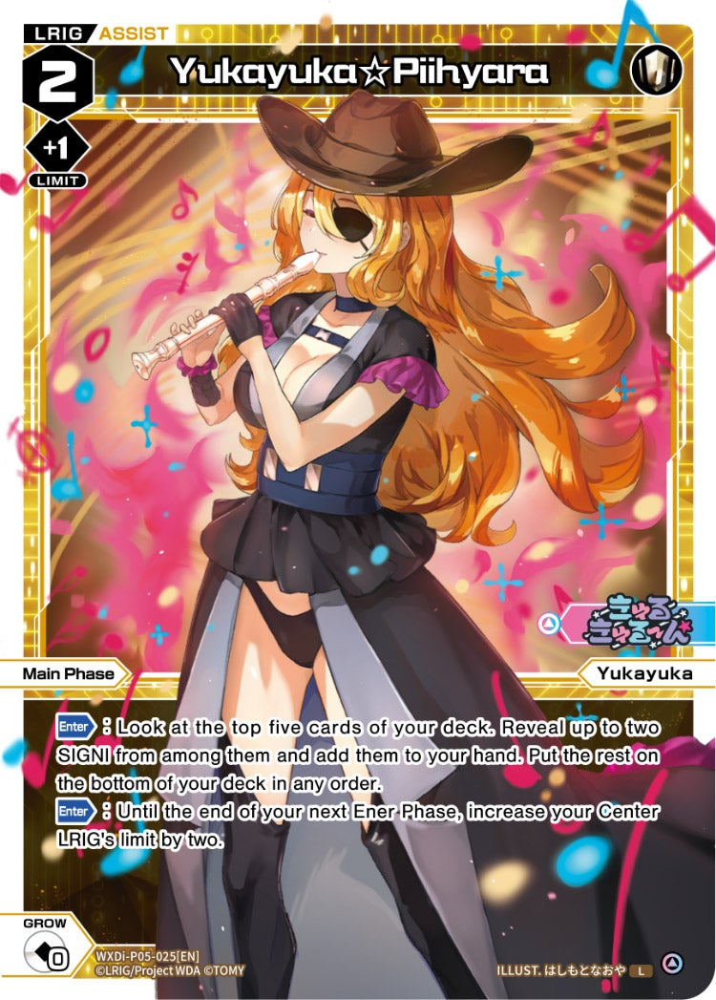

# Yukayuka☆Piihyara

## Thông tin lá

| Trường | Giá trị |
| --- | --- |
| Mã in | WXDi-P05-025[EN] |
| Set | WXDi-P05[EN] |
| Số thứ tự | 025 |
| Loại thẻ | ASSIST LRIG |
| Vị trí | LRIG Deck |
| Số bản | — (set booster, không áp dụng) |
| Màu | Trắng |
| Độ hiếm | L,L(P) |
| Minh họa | はしもとなおや |
| Level | 2 |
| Limit | ＋1 |
| Power | 0 |
| LRIG type / Class | Yukayuka |
| Team / Master | Kyurukyurun☆ |
| Cost | — |
| Grow cost | 《C》×０ |
| Use timing | Main Phase |
| Life Burst | Không |

## Card text chính thức

[Enter]: Look at the top five cards of your deck. Reveal up to two SIGNI from among them and add them to your hand. Put the rest on the bottom of your deck in any order.
[Enter]: Until the end of your next Ener Phase, increase your Center LRIG's limit by two.

## Power text / Life Burst

—

## Ghi chú minh họa
Artist: はしもとなおや. Ảnh L được tải từ Card List tiếng Anh.

## FAQ chính thức

— (không có FAQ riêng cho mã này trên trang FAQ tiếng Anh.)

## Ảnh biến thể

- [L(P)](../images/WXDi-P05-025P-EN.jpg)

## Nguồn
[Card List/FAQ chính thức](https://www.takaratomy.co.jp/products/en.wixoss/card/card.html?card_no=WXDi-P05-025%5BEN%5D ) · [Ảnh thẻ](https://www.takaratomy.co.jp/products/en.wixoss/card/thumb/WXDi-P05-025%5BEN%5D.jpg)
