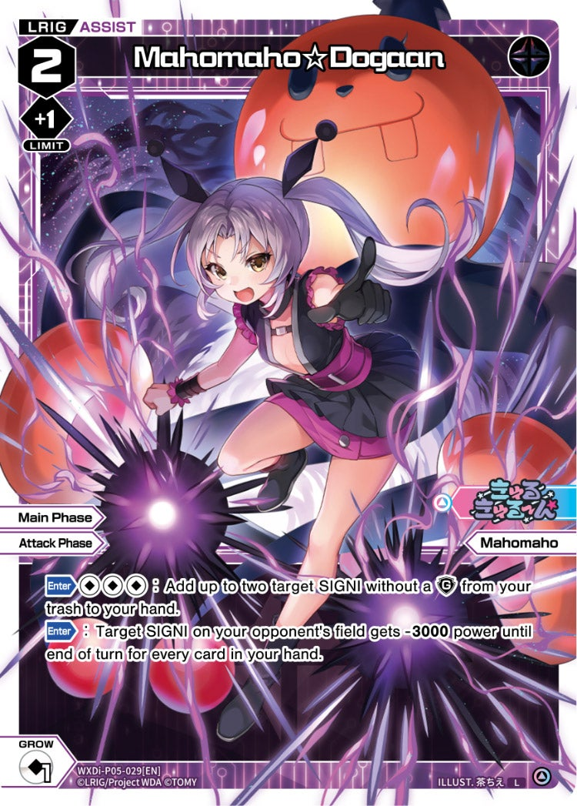

# Mahomaho☆Dogaan

## Thông tin lá

| Trường | Giá trị |
| --- | --- |
| Mã in | WXDi-P05-029[EN] |
| Set | WXDi-P05[EN] |
| Số thứ tự | 029 |
| Loại thẻ | ASSIST LRIG |
| Vị trí | LRIG Deck |
| Số bản | — (set booster, không áp dụng) |
| Màu | Đen |
| Độ hiếm | L,L(P) |
| Minh họa | 茶ちえ |
| Level | 2 |
| Limit | ＋1 |
| Power | 0 |
| LRIG type / Class | Mahomaho |
| Team / Master | Kyurukyurun☆ |
| Cost | — |
| Grow cost | 《C》×１ |
| Use timing | Main Phase
Attack Phase |
| Life Burst | Không |

## Card text chính thức

[Enter] {Colorless} {Colorless} {Colorless}: Add up to two target SIGNI without a {Guard Icon} from your trash to your hand.
[Enter]: Target SIGNI on your opponent's field gets -3000 power until end of turn for every card in your hand.

## Power text / Life Burst

—

## Ghi chú minh họa
Artist: 茶ちえ. Ảnh L được tải từ Card List tiếng Anh.

## FAQ chính thức

**Q. May a card paid as the cost of the first [Enter] ability be put into my hand with the same effect?**
A. Yes, you can. After paying the cost of that ability, target a card from your trash that meets the conditions.

**Q. If I put two SIGNIs into my hand from my trash with the first [Enter] ability and then triggered the second [Enter] ability, may I effect my opponent's SIGNI based on the increased number of my hand?**
A. Yes, you can. Each of [Enter] abilities triggers when this card enters the field, but the second [Enter] ability check the number of cards in your hand when it resolves.

## Ảnh biến thể

- [L(P)](../images/WXDi-P05-029P-EN.jpg)

## Nguồn
[Card List/FAQ chính thức](https://www.takaratomy.co.jp/products/en.wixoss/card/card.html?card_no=WXDi-P05-029%5BEN%5D ) · [Ảnh thẻ](https://www.takaratomy.co.jp/products/en.wixoss/card/thumb/WXDi-P05-029%5BEN%5D.jpg)
