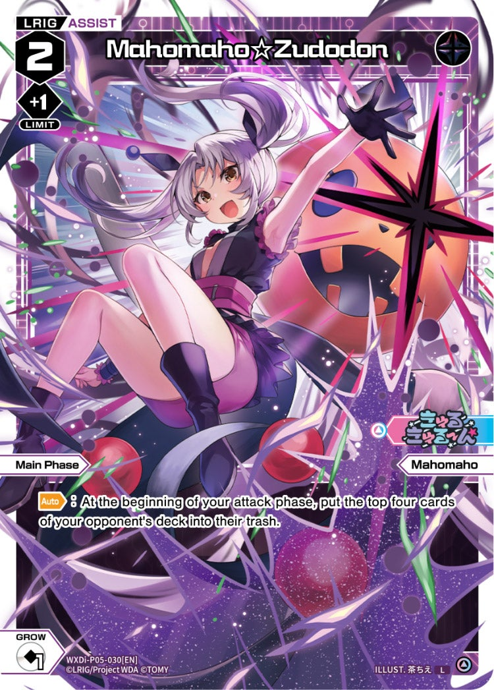

# Mahomaho☆Zudodon

## Thông tin lá

| Trường | Giá trị |
| --- | --- |
| Mã in | WXDi-P05-030[EN] |
| Set | WXDi-P05[EN] |
| Số thứ tự | 030 |
| Loại thẻ | ASSIST LRIG |
| Vị trí | LRIG Deck |
| Số bản | — (set booster, không áp dụng) |
| Màu | Đen |
| Độ hiếm | L,L(P) |
| Minh họa | 茶ちえ |
| Level | 2 |
| Limit | ＋1 |
| Power | 0 |
| LRIG type / Class | Mahomaho |
| Team / Master | Kyurukyurun☆ |
| Cost | — |
| Grow cost | 《C》×１ |
| Use timing | Main Phase |
| Life Burst | Không |

## Card text chính thức

[Auto]: At the beginning of your attack phase, put the top four cards of your opponent's deck into their trash.

## Power text / Life Burst

—

## Ghi chú minh họa
Artist: 茶ちえ. Ảnh L được tải từ Card List tiếng Anh.

## FAQ chính thức

**Q. What happens there are three or less cards in my opponent's deck when this card's [Auto] ability is triggered?**
A. In that case, put all those three or less cards into their owner's trash from your opponent's deck. After that, there are no cards in your opponent's deck, so your opponent refresh the deck.

## Ảnh biến thể

- [L(P)](../images/WXDi-P05-030P-EN.jpg)

## Nguồn
[Card List/FAQ chính thức](https://www.takaratomy.co.jp/products/en.wixoss/card/card.html?card_no=WXDi-P05-030%5BEN%5D ) · [Ảnh thẻ](https://www.takaratomy.co.jp/products/en.wixoss/card/thumb/WXDi-P05-030%5BEN%5D.jpg)
