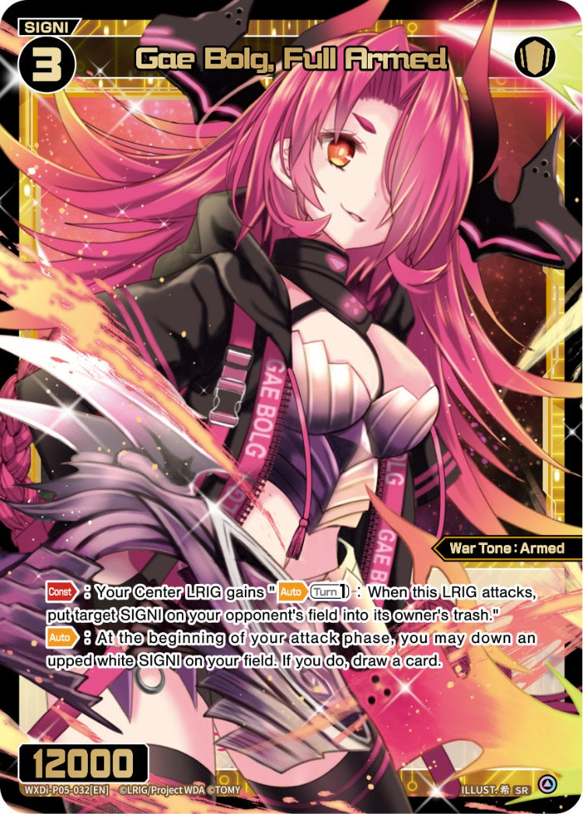

# Gae Bolg, Full Armed

## Thông tin lá

| Trường | Giá trị |
| --- | --- |
| Mã in | WXDi-P05-032[EN] |
| Set | WXDi-P05[EN] |
| Số thứ tự | 032 |
| Loại thẻ | SIGNI |
| Vị trí | Main Deck |
| Số bản | — (set booster, không áp dụng) |
| Màu | Trắng |
| Độ hiếm | SR |
| Minh họa | 希 |
| Level | 3 |
| Limit | — |
| Power | 12000 |
| LRIG type / Class | War Tone：Armed |
| Team / Master | — |
| Cost | — |
| Grow cost | — |
| Use timing | — |
| Life Burst | Không |

## Card text chính thức

[Constant]: Your Center LRIG gains "[Auto] {1/Turn}: When this LRIG attacks, put target SIGNI on your opponent's field into its owner's trash."
[Auto]: At the beginning of your attack phase, you may down an upped white SIGNI on your field. If you do, draw a card.

## Power text / Life Burst

—

## Ghi chú minh họa
Artist: 希. Ảnh SR được tải từ Card List tiếng Anh.

## FAQ chính thức

**Q. If two《Gae Bolg, Full Armed》 are on my field, does Center LRIG get two [Auto] abilities?**
A. Yes, your Center LRIG gains two [Auto] abilities. Those abilities are triggered when your Center LRIG attacks. You may put two target SIGNIs into your opponent's trash.

## Nguồn
[Card List/FAQ chính thức](https://www.takaratomy.co.jp/products/en.wixoss/card/card.html?card_no=WXDi-P05-032%5BEN%5D ) · [Ảnh thẻ](https://www.takaratomy.co.jp/products/en.wixoss/card/thumb/WXDi-P05-032%5BEN%5D.jpg)
