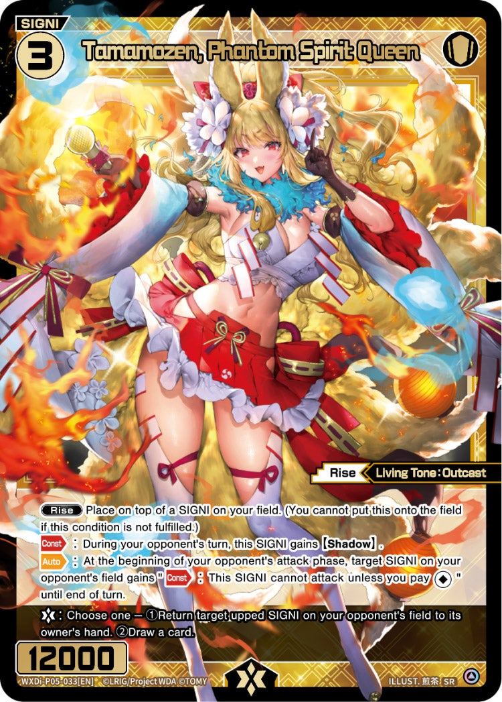

# Tamamozen, Phantom Spirit Queen

## Thông tin lá

| Trường | Giá trị |
| --- | --- |
| Mã in | WXDi-P05-033[EN] |
| Set | WXDi-P05[EN] |
| Số thứ tự | 033 |
| Loại thẻ | SIGNI |
| Vị trí | Main Deck |
| Số bản | — (set booster, không áp dụng) |
| Màu | Trắng |
| Độ hiếm | SR |
| Minh họa | 煎茶 |
| Level | 3 |
| Limit | — |
| Power | 12000 |
| LRIG type / Class | Living Tone：Outcast |
| Team / Master | — |
| Cost | — |
| Grow cost | — |
| Use timing | — |
| Life Burst | Có |

## Card text chính thức

[Rise] Place on top of a SIGNI on your field. (You cannot put this onto the field if this condition is not fulfilled.)
[Constant]: During your opponent's turn, this SIGNI gains 【Shadow】.
[Auto]: At the beginning of your opponent's attack phase, target SIGNI on your opponent's field gains "[Constant]: This SIGNI cannot attack unless you pay {Colorless}" until end of turn.

## Power text / Life Burst

Choose one — ①Return target upped SIGNI on your opponent's field to its owner's hand. ②Draw a card.

## Ghi chú minh họa
Artist: 煎茶. Ảnh SR được tải từ Card List tiếng Anh.

## FAQ chính thức

**Q. Two 《Tamamozen, Phantom Spirit Queen》 triggered their [Auto] abilities at the beginning of my opponent's aAttack phase. If each effect targets the same SIGNI, how many Ener Cost must my opponent pay for that SIGNI to attack?**
A. That SIGNI cannot attack unless your opponent pays a total Ener Cost of {Colorless} {Colorless}. Each ability is gained separately, and your opponent must pay {Colorless} for both of them if that SIGNI attacks.

## Nguồn
[Card List/FAQ chính thức](https://www.takaratomy.co.jp/products/en.wixoss/card/card.html?card_no=WXDi-P05-033%5BEN%5D ) · [Ảnh thẻ](https://www.takaratomy.co.jp/products/en.wixoss/card/thumb/WXDi-P05-033%5BEN%5D.jpg)
