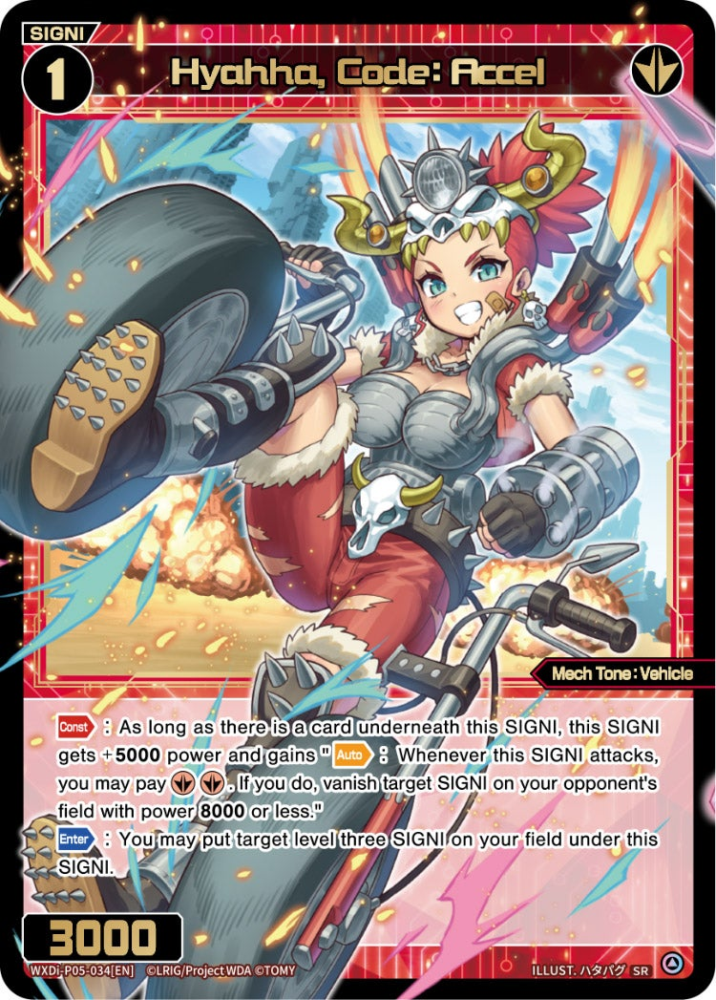

# Hyahha, Code: Accel

## Thông tin lá

| Trường | Giá trị |
| --- | --- |
| Mã in | WXDi-P05-034[EN] |
| Set | WXDi-P05[EN] |
| Số thứ tự | 034 |
| Loại thẻ | SIGNI |
| Vị trí | Main Deck |
| Số bản | — (set booster, không áp dụng) |
| Màu | Đỏ |
| Độ hiếm | SR |
| Minh họa | ハタパグ |
| Level | 1 |
| Limit | — |
| Power | 3000 |
| LRIG type / Class | Mech Tone：Vehicle |
| Team / Master | — |
| Cost | — |
| Grow cost | — |
| Use timing | — |
| Life Burst | Không |

## Card text chính thức

[Constant]: As long as there is a card underneath this SIGNI, this SIGNI gets +5000 power and gains "[Auto]: Whenever this SIGNI attacks, you may pay {Red} {Red}. If you do, vanish target SIGNI on your opponent's field with power 8000 or less."
[Enter]: You may put target level three SIGNI on your field under this SIGNI.

## Power text / Life Burst

—

## Ghi chú minh họa
Artist: ハタパグ. Ảnh SR được tải từ Card List tiếng Anh.

## FAQ chính thức

**Q. May I target a Level three SIGNI to put under this card from my hand or Ener Zone by this card's [Enter] ability ?**
A. No, you cannot. You may only target SIGNI on a SIGNI Zone. If you target a SIGNI without specifying the zone, only a SIGNI on a SIGNI Zone is targeted.

## Nguồn
[Card List/FAQ chính thức](https://www.takaratomy.co.jp/products/en.wixoss/card/card.html?card_no=WXDi-P05-034%5BEN%5D ) · [Ảnh thẻ](https://www.takaratomy.co.jp/products/en.wixoss/card/thumb/WXDi-P05-034%5BEN%5D.jpg)
