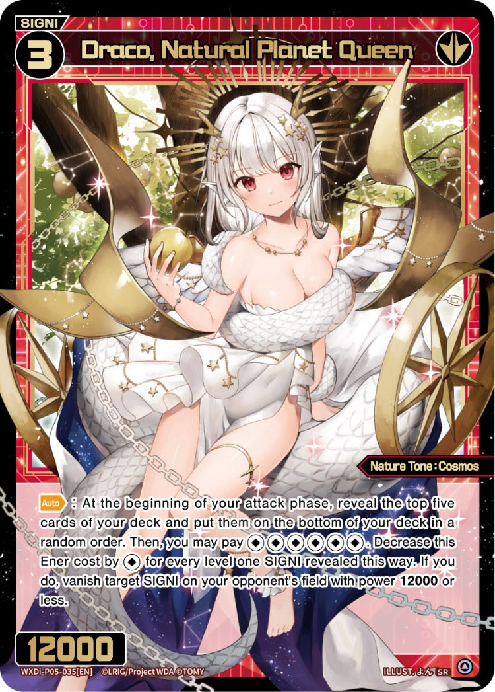

# Draco, Natural Planet Queen

## Thông tin lá

| Trường | Giá trị |
| --- | --- |
| Mã in | WXDi-P05-035[EN] |
| Set | WXDi-P05[EN] |
| Số thứ tự | 035 |
| Loại thẻ | SIGNI |
| Vị trí | Main Deck |
| Số bản | — (set booster, không áp dụng) |
| Màu | Đỏ |
| Độ hiếm | SR |
| Minh họa | よん |
| Level | 3 |
| Limit | — |
| Power | 12000 |
| LRIG type / Class | Nature Tone：Cosmos |
| Team / Master | — |
| Cost | — |
| Grow cost | — |
| Use timing | — |
| Life Burst | Không |

## Card text chính thức

[Auto]: At the beginning of your attack phase, reveal the top five cards of your deck and put them on the bottom of your deck in a random order. Then, you may pay {Colorless} {Colorless} {Colorless} {Colorless} {Colorless} {Colorless}. Decrease this Ener cost by {Colorless} for every level one SIGNI revealed this way. If you do, vanish target SIGNI on your opponent's field with power 12000 or less.

## Power text / Life Burst

—

## Ghi chú minh họa
Artist: よん. Ảnh SR được tải từ Card List tiếng Anh.

## FAQ chính thức

**Q. What happens if there are four or less cards in my deck at the beginning of the aAttack phase?**
A. In that case, those four or less cards are revealed, then shuffled them, and returned to your deck. After that, the process of effect is the same as usual. After the effect is resolved, there is more than one card in your deck, so you do not need refresh it.

**Q. If there are two 《Draco, Natural Planet Queen》 on my field, how does process the [Auto] ability at the beginning of the aAttack phase?**
A. Both of the abilities at the beginning of the aAttack phase is triggered separately. The first [Auto] ability triggers and reveals the top five cards of your deck, processes its effect. Then the second [Auto] ability triggers and reveals the top five cards of your deck, processes its effect again.

**Q. Do I still need to reveal the top five cards of my deck by the [Auto] ability even if there are no SIGNIs on my opponent's field?**
A. Yes, the [Auto] ability must be triggered when the conditions are met, so this ability must be triggered at the beginning of the aAttack phase, and it also must be revealed the top five cards of your deck.

**Q. I revealed the top five cards of my deck by the [Auto] ability, but there are not have level one SIGNIs. May I choose not to pay {Colorless} {Colorless} {Colorless} {Colorless} {Colorless} {Colorless}?**
A. Yes, you can choose. If you do not pay {Colorless} {Colorless} {Colorless} {Colorless} {Colorless} {Colorless}, you do not target your opponent's SIGNI.

## Nguồn
[Card List/FAQ chính thức](https://www.takaratomy.co.jp/products/en.wixoss/card/card.html?card_no=WXDi-P05-035%5BEN%5D ) · [Ảnh thẻ](https://www.takaratomy.co.jp/products/en.wixoss/card/thumb/WXDi-P05-035%5BEN%5D.jpg)
