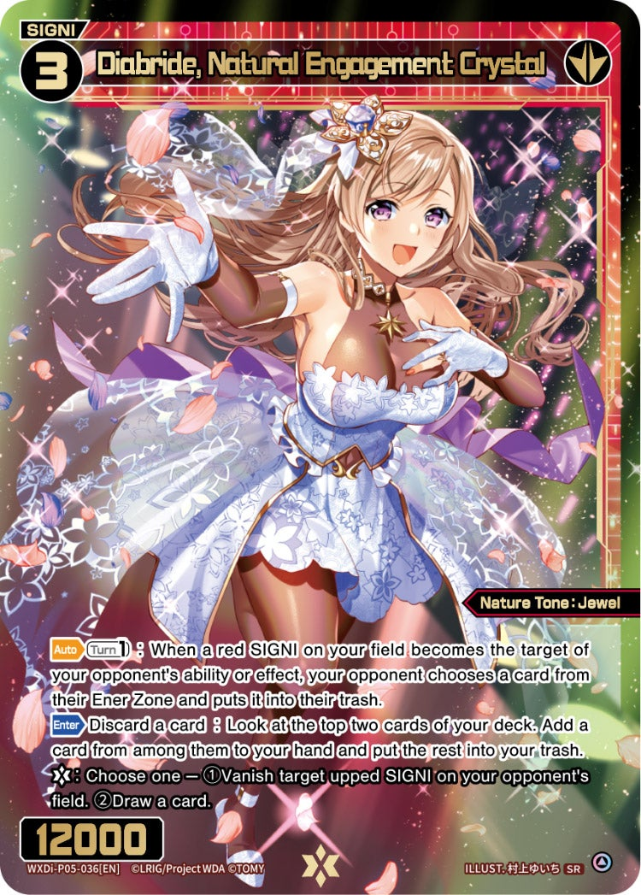

# Diabride, Natural Engagement Crystal

## Thông tin lá

| Trường | Giá trị |
| --- | --- |
| Mã in | WXDi-P05-036[EN] |
| Set | WXDi-P05[EN] |
| Số thứ tự | 036 |
| Loại thẻ | SIGNI |
| Vị trí | Main Deck |
| Số bản | — (set booster, không áp dụng) |
| Màu | Đỏ |
| Độ hiếm | SR |
| Minh họa | 村上ゆいち |
| Level | 3 |
| Limit | — |
| Power | 12000 |
| LRIG type / Class | Nature Tone：Jewel |
| Team / Master | — |
| Cost | — |
| Grow cost | — |
| Use timing | — |
| Life Burst | Có |

## Card text chính thức

[Auto] {1/Turn}: When a red SIGNI on your field becomes the target of your opponent's ability or effect, your opponent chooses a card from their Ener Zone and puts it into their trash.
[Enter] Discard a card: Look at the top two cards of your deck. Add a card from among them to your hand and put the rest into your trash.

## Power text / Life Burst

Choose one — ①Vanish target upped SIGNI on your opponent's field. ②Draw a card.

## Ghi chú minh họa
Artist: 村上ゆいち. Ảnh SR được tải từ Card List tiếng Anh.

## FAQ chính thức

**Q. Does this card's [Auto] ability also trigger when this SIGNI itself is targeted?**
A. Yes, its [Auto] ability is triggered.

**Q. What happens to this card's [Auto] ability if this SIGNI becomes the target of a "vanish target SIGNI" effect or a "target SIGNI lose all abilities" effect?**
A. In that case, the [Auto] ability is still triggered when it is targeted. After that, by processing the effect of "vanish target SIGNI" or "target SIGNI lose all abilities", 《Diabride, Natural Engagement Crystal》 leaves the field or loses all abilities, but the triggered [Auto] ability is still resolved.

## Nguồn
[Card List/FAQ chính thức](https://www.takaratomy.co.jp/products/en.wixoss/card/card.html?card_no=WXDi-P05-036%5BEN%5D ) · [Ảnh thẻ](https://www.takaratomy.co.jp/products/en.wixoss/card/thumb/WXDi-P05-036%5BEN%5D.jpg)
