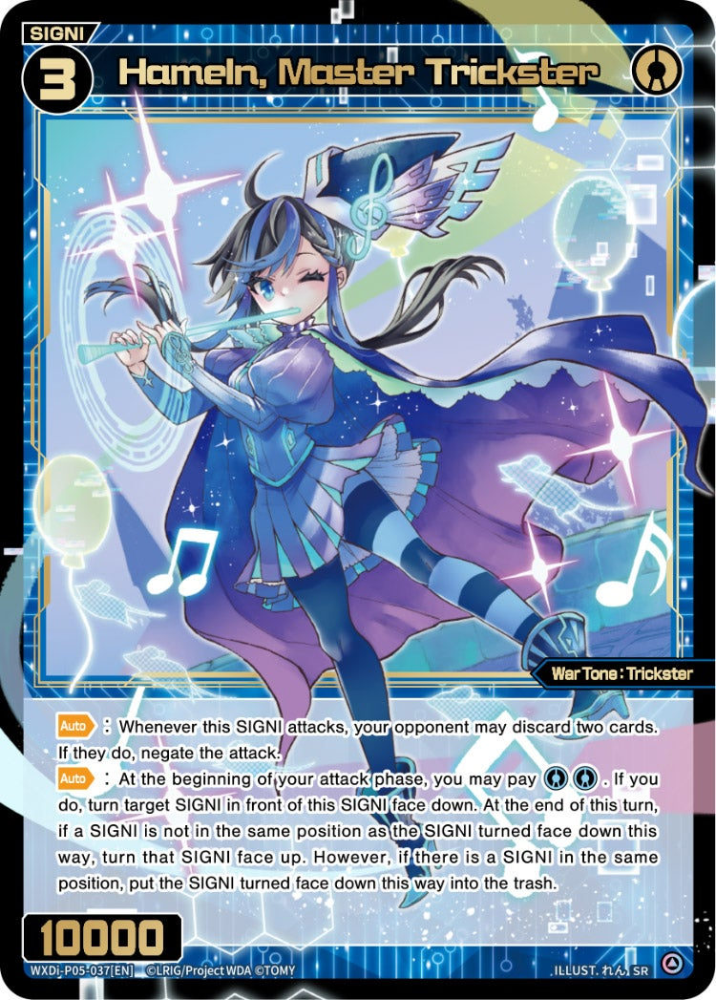

# Hameln, Master Trickster

## Thông tin lá

| Trường | Giá trị |
| --- | --- |
| Mã in | WXDi-P05-037[EN] |
| Set | WXDi-P05[EN] |
| Số thứ tự | 037 |
| Loại thẻ | SIGNI |
| Vị trí | Main Deck |
| Số bản | — (set booster, không áp dụng) |
| Màu | Xanh dương |
| Độ hiếm | SR |
| Minh họa | れん |
| Level | 3 |
| Limit | — |
| Power | 10000 |
| LRIG type / Class | War Tone：Trickster |
| Team / Master | — |
| Cost | — |
| Grow cost | — |
| Use timing | — |
| Life Burst | Không |

## Card text chính thức

[Auto]: Whenever this SIGNI attacks, your opponent may discard two cards. If they do, negate the attack.
[Auto]: At the beginning of your attack phase, you may pay {Blue} {Blue}. If you do, turn target SIGNI in front of this SIGNI face down. At the end of this turn, if a SIGNI is not in the same position as the SIGNI turned face down this way, turn that SIGNI face up. However, if there is a SIGNI in the same position, put the SIGNI turned face down this way into the trash.

## Power text / Life Burst

—

## Ghi chú minh họa
Artist: れん. Ảnh SR được tải từ Card List tiếng Anh.

## FAQ chính thức

**Q. Which player decides whether to discard cards from player's hand by the first [Auto] ability?**
A. Your opponent decides whether or not to discard two cards from your opponent's hand. Note that your opponent cannot choose to discard if there are one or less cards in your opponent's hand.

**Q. Where exactly is the same position that the second [Auto] ability refers to?**
A. It will basically be the same SIGNI Zone. It does not matter if there is a SIGNI on the SIGNI Zone other than the card you turned face down.

## Nguồn
[Card List/FAQ chính thức](https://www.takaratomy.co.jp/products/en.wixoss/card/card.html?card_no=WXDi-P05-037%5BEN%5D ) · [Ảnh thẻ](https://www.takaratomy.co.jp/products/en.wixoss/card/thumb/WXDi-P05-037%5BEN%5D.jpg)
