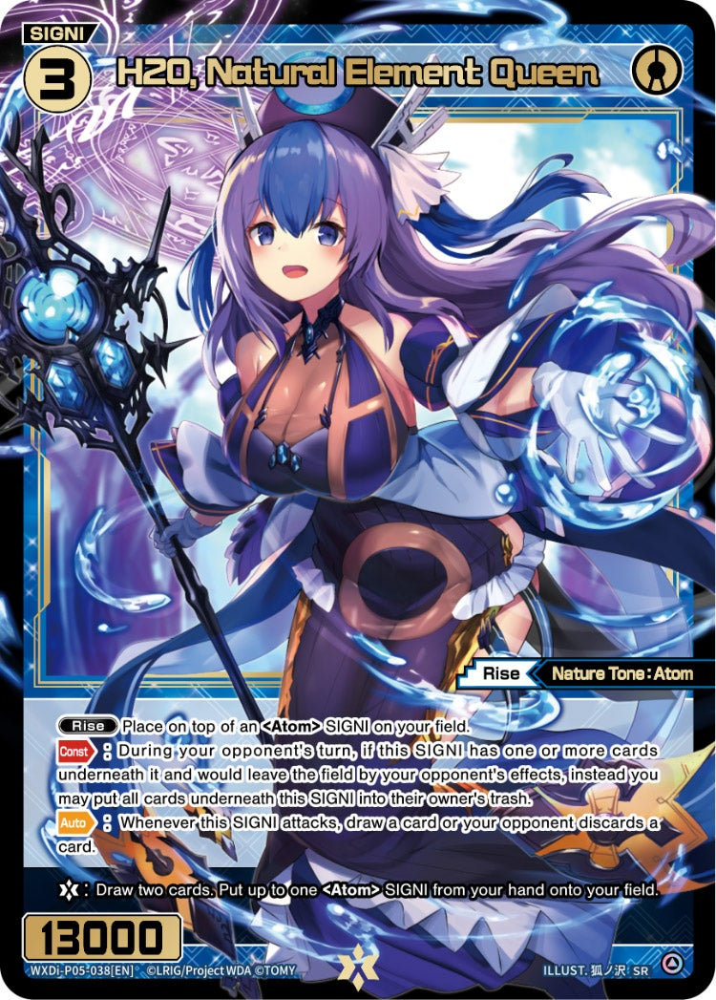

# H2O, Natural Element Queen

## Thông tin lá

| Trường | Giá trị |
| --- | --- |
| Mã in | WXDi-P05-038[EN] |
| Set | WXDi-P05[EN] |
| Số thứ tự | 038 |
| Loại thẻ | SIGNI |
| Vị trí | Main Deck |
| Số bản | — (set booster, không áp dụng) |
| Màu | Xanh dương |
| Độ hiếm | SR |
| Minh họa | 狐ノ沢 |
| Level | 3 |
| Limit | — |
| Power | 13000 |
| LRIG type / Class | Nature Tone：Atom |
| Team / Master | — |
| Cost | — |
| Grow cost | — |
| Use timing | — |
| Life Burst | Có |

## Card text chính thức

[Rise] Place on top of an <Atom> SIGNI on your field.
[Constant]: During your opponent's turn, if this SIGNI has one or more cards underneath it and would leave the field by your opponent's effects, instead you may put all cards underneath this SIGNI into their owner's trash.
[Auto]: Whenever this SIGNI attacks, draw a card or your opponent discards a card.

## Power text / Life Burst

Draw two cards. Put up to one <Atom> SIGNI from your hand onto your field.

## Ghi chú minh họa
Artist: 狐ノ沢. Ảnh SR được tải từ Card List tiếng Anh.

## FAQ chính thức

**Q. I triggered Life Burst when I had zero cards in my hand. May I draw two cards and put a <Atom> SIGNI onto my field from my hand?**
A. Yes, you can. After drawing two cards, you may choose any <Atom> SIGNI from your hand including them, and put a <Atom> SIGNI onto the field from your hand.

## Nguồn
[Card List/FAQ chính thức](https://www.takaratomy.co.jp/products/en.wixoss/card/card.html?card_no=WXDi-P05-038%5BEN%5D ) · [Ảnh thẻ](https://www.takaratomy.co.jp/products/en.wixoss/card/thumb/WXDi-P05-038%5BEN%5D.jpg)
