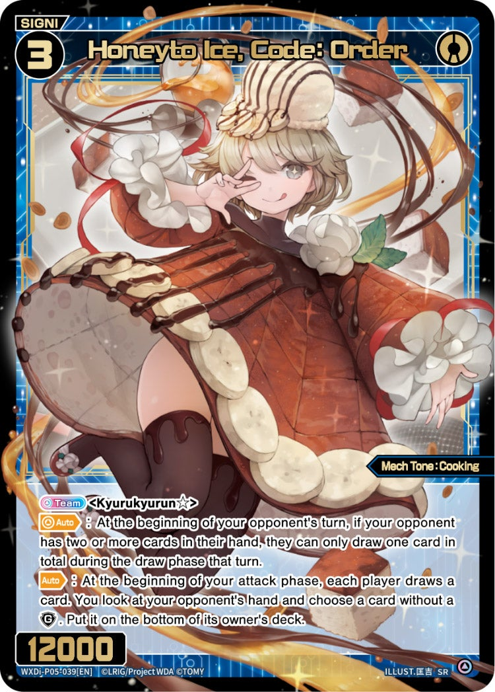

# Honeyto Ice, Code: Order

## Thông tin lá

| Trường | Giá trị |
| --- | --- |
| Mã in | WXDi-P05-039[EN] |
| Set | WXDi-P05[EN] |
| Số thứ tự | 039 |
| Loại thẻ | SIGNI |
| Vị trí | Main Deck |
| Số bản | — (set booster, không áp dụng) |
| Màu | Xanh dương |
| Độ hiếm | SR |
| Minh họa | 匡吉 |
| Level | 3 |
| Limit | — |
| Power | 12000 |
| LRIG type / Class | Mech Tone：Cooking |
| Team / Master | — |
| Cost | — |
| Grow cost | — |
| Use timing | — |
| Life Burst | Không |

## Card text chính thức

[Team] <Kyurukyurun☆>
[Team Auto]: At the beginning of your opponent's turn, if your opponent has two or more cards in their hand, they can only draw one card in total during the draw phase that turn.
[Auto]: At the beginning of your attack phase, each player draws a card. You look at your opponent's hand and choose a card without a {Guard Icon}. Put it on the bottom of its owner's deck.

## Power text / Life Burst

—

## Ghi chú minh họa
Artist: 匡吉. Ảnh SR được tải từ Card List tiếng Anh.

## FAQ chính thức

**Q. When two 《Honeyto Ice, Code: Order》 in my field. My opponent has two or more cards in my opponent's hand, and both of them were triggered their [Team Auto] abilities. What happens?**
A. Each [Team Auto] ability is triggered, but both have the same effect, so your opponent can only draw a total of one card during your opponent's draw phase, the same as if one of 《Honeyto Ice, Code: Order》 on your field. It does not mean that the number of cards to be drawn becomes zero.

## Nguồn
[Card List/FAQ chính thức](https://www.takaratomy.co.jp/products/en.wixoss/card/card.html?card_no=WXDi-P05-039%5BEN%5D ) · [Ảnh thẻ](https://www.takaratomy.co.jp/products/en.wixoss/card/thumb/WXDi-P05-039%5BEN%5D.jpg)
