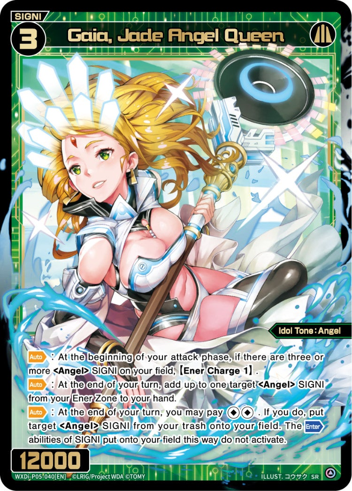

# Gaia, Jade Angel Queen

## Thông tin lá

| Trường | Giá trị |
| --- | --- |
| Mã in | WXDi-P05-040[EN] |
| Set | WXDi-P05[EN] |
| Số thứ tự | 040 |
| Loại thẻ | SIGNI |
| Vị trí | Main Deck |
| Số bản | — (set booster, không áp dụng) |
| Màu | Xanh lá |
| Độ hiếm | SR |
| Minh họa | コウサク |
| Level | 3 |
| Limit | — |
| Power | 12000 |
| LRIG type / Class | Idol Tone：Angel |
| Team / Master | — |
| Cost | — |
| Grow cost | — |
| Use timing | — |
| Life Burst | Không |

## Card text chính thức

[Auto]: At the beginning of your attack phase, if there are three or more <Angel> SIGNI on your field, 【Ener Charge 1】.
[Auto]: At the end of your turn, add up to one target <Angel> SIGNI from your Ener Zone to your hand.
[Auto]: At the end of your turn, you may pay {Colorless} {Colorless}. If you do, put target <Angel> SIGNI from your trash onto your field. The [Enter] abilities of SIGNI put onto your field this way do not activate.

## Power text / Life Burst

—

## Ghi chú minh họa
Artist: コウサク. Ảnh SR được tải từ Card List tiếng Anh.

## FAQ chính thức

**Q. If the {Colorless} cost paid from your Ener Zone is an <Angel> SIGNI by the third [Auto] ability, may I target it after it has been put into your trash from your Ener Zone and put it onto the field?**
A. No, you cannot. This ability pays the Ener Cost after you targeted a <Angel> SIGNI first.

## Nguồn
[Card List/FAQ chính thức](https://www.takaratomy.co.jp/products/en.wixoss/card/card.html?card_no=WXDi-P05-040%5BEN%5D ) · [Ảnh thẻ](https://www.takaratomy.co.jp/products/en.wixoss/card/thumb/WXDi-P05-040%5BEN%5D.jpg)
