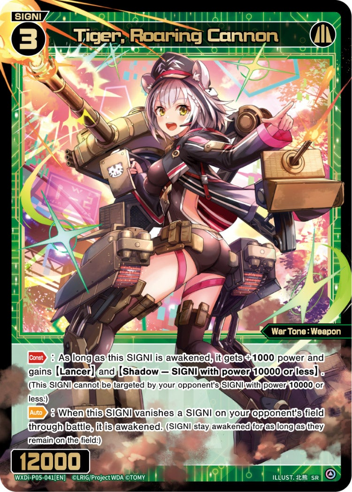

# Tiger, Roaring Cannon

## Thông tin lá

| Trường | Giá trị |
| --- | --- |
| Mã in | WXDi-P05-041[EN] |
| Set | WXDi-P05[EN] |
| Số thứ tự | 041 |
| Loại thẻ | SIGNI |
| Vị trí | Main Deck |
| Số bản | — (set booster, không áp dụng) |
| Màu | Xanh lá |
| Độ hiếm | SR |
| Minh họa | 北熊 |
| Level | 3 |
| Limit | — |
| Power | 12000 |
| LRIG type / Class | War Tone：Weapon |
| Team / Master | — |
| Cost | — |
| Grow cost | — |
| Use timing | — |
| Life Burst | Không |

## Card text chính thức

[Constant]: As long as this SIGNI is awakened, it gets +1000 power and gains 【Lancer】 and 【Shadow — SIGNI with power 10000 or less】. (This SIGNI cannot be targeted by your opponent's SIGNI with power 10000 or less.)
[Auto]: When this SIGNI vanishes a SIGNI on your opponent's field through battle, it is awakened. (SIGNI stay awakened for as long as they remain on the field.)

## Power text / Life Burst

—

## Ghi chú minh họa
Artist: 北熊. Ảnh SR được tải từ Card List tiếng Anh.

## FAQ chính thức

**Q. What is "awakened"?**
A. SIGNI may be awakened by the effect of SIGNI and gain an awakened state. An awakened SIGNI remains awakened for as long as that SIGNI on the field, even if the Turn Player changes. If this card is moved to another zone, such as the hand, and then put onto your field again, or if it is turned face down with the effect of 《Robin Hood, Jade General Queen》, etc. and then returned to face up, it is lose awakened state.

**Q. Is the [Shadow (SIGNI)] ability no longer targeted by a SIGNI's Life Burst ability?**
A. Yes, Life Burst can also be prevented from being targeted by this ability if it is SIGNI.

**Q. My opponent's Life Burst was triggered and it was a SIGNI with 6000 power. If my opponent's SIGNI has the [Constant] ability to "All SIGNI on your field get +5000 power", May my opponent's Life Burst target this awakend SIGNI?**
A. No, it cannot be targeted by [Shadow]. The [Constant] ability to add power only affects SIGNIs in the field (in this case, the SIGNI Zone) unless a specific zone is specified. The power of that SIGNI triggered by Life Burst remains 6000 power, so this SIGNI is not targeted by [Shadow - SIGNI with power 10000 or less].

## Nguồn
[Card List/FAQ chính thức](https://www.takaratomy.co.jp/products/en.wixoss/card/card.html?card_no=WXDi-P05-041%5BEN%5D ) · [Ảnh thẻ](https://www.takaratomy.co.jp/products/en.wixoss/card/thumb/WXDi-P05-041%5BEN%5D.jpg)
