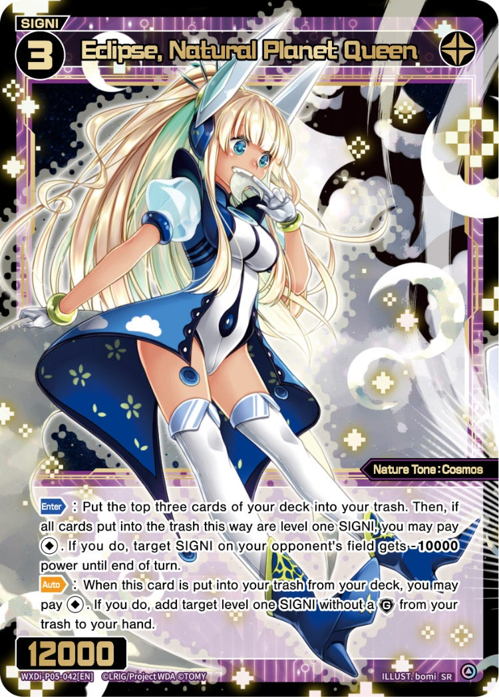

# Eclipse, Natural Planet Queen

## Thông tin lá

| Trường | Giá trị |
| --- | --- |
| Mã in | WXDi-P05-042[EN] |
| Set | WXDi-P05[EN] |
| Số thứ tự | 042 |
| Loại thẻ | SIGNI |
| Vị trí | Main Deck |
| Số bản | — (set booster, không áp dụng) |
| Màu | Đen |
| Độ hiếm | SR |
| Minh họa | bomi |
| Level | 3 |
| Limit | — |
| Power | 12000 |
| LRIG type / Class | Nature Tone：Cosmos |
| Team / Master | — |
| Cost | — |
| Grow cost | — |
| Use timing | — |
| Life Burst | Không |

## Card text chính thức

[Enter]: Put the top three cards of your deck into your trash. Then, if all cards put into the trash this way are level one SIGNI, you may pay {Colorless}. If you do, target SIGNI on your opponent's field gets -10000 power until end of turn.

[Auto]: When this card is put into your trash from your deck, you may pay {Colorless}. If you do, add target level one SIGNI without a {Guard Icon} from your trash to your hand.

## Power text / Life Burst

—

## Ghi chú minh họa
Artist: bomi. Ảnh SR được tải từ Card List tiếng Anh.

## FAQ chính thức

**Q. What happens there is one card in my deck when this card triggered the [Enter] ability?**
A. In that case, put one card into your trash from your deck. If it is a level one SIGNI, you may target your opponent's SIGNI and pay {Colorless} to get -10000 power. After that, refresh your deck as there is no cards in your deck.

**Q. The effect "put the top three cards of your deck into your trash" put 《Eclipse, Natural Planet Queen》 from your deck to your trash, but at the same time the number of cards in your deck became zero. What happens?**
A. In that case, the [Auto] ability of《Eclipse, Natural Planet Queen》 triggers, but since your deck is zero cards, your deck is refreshed before it triggers. You resolve its effect after the refresh, but you shffle the cards in your trash to creat a new deck, basically you cannot put a card into your hand since there are no cards in your trash. If a card that meets the conditions was placed in your trash before this ability resolves due to the refresh process (placing a life cross in your trash) or other effects, you may put it into your hand.

## Nguồn
[Card List/FAQ chính thức](https://www.takaratomy.co.jp/products/en.wixoss/card/card.html?card_no=WXDi-P05-042%5BEN%5D ) · [Ảnh thẻ](https://www.takaratomy.co.jp/products/en.wixoss/card/thumb/WXDi-P05-042%5BEN%5D.jpg)
