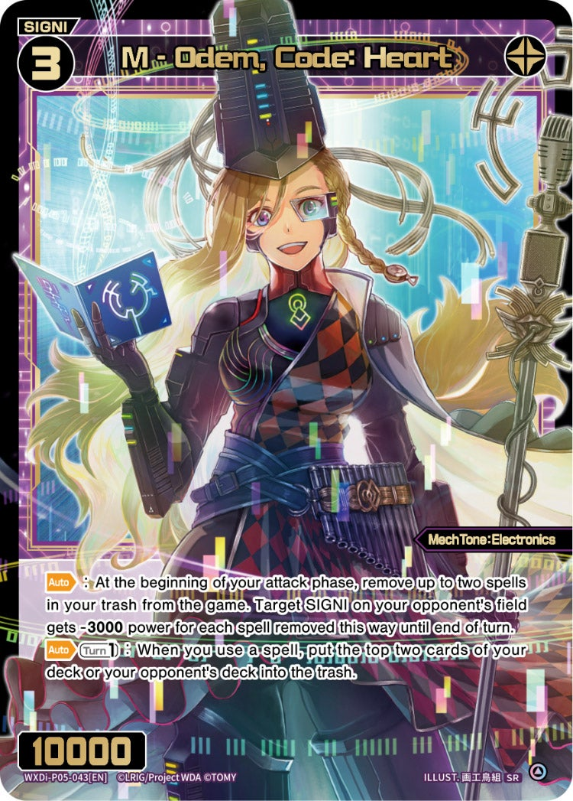

# M - Odem, Code: Heart

## Thông tin lá

| Trường | Giá trị |
| --- | --- |
| Mã in | WXDi-P05-043[EN] |
| Set | WXDi-P05[EN] |
| Số thứ tự | 043 |
| Loại thẻ | SIGNI |
| Vị trí | Main Deck |
| Số bản | — (set booster, không áp dụng) |
| Màu | Đen |
| Độ hiếm | SR |
| Minh họa | 画工鳥組 |
| Level | 3 |
| Limit | — |
| Power | 10000 |
| LRIG type / Class | Mech Tone：Electronics |
| Team / Master | — |
| Cost | — |
| Grow cost | — |
| Use timing | — |
| Life Burst | Không |

## Card text chính thức

[Auto]: At the beginning of your attack phase, remove up to two spells in your trash from the game. Target SIGNI on your opponent's field gets -3000 power for each spell removed this way until end of turn.
[Auto] {1/Turn}: When you use a spell, put the top two cards of your deck or your opponent's deck into the trash.

## Power text / Life Burst

—

## Ghi chú minh họa
Artist: 画工鳥組. Ảnh SR được tải từ Card List tiếng Anh.

## FAQ chính thức

**Q. Does the [Auto] ability of "When you use a spell" trigger if I trigger a Life Burst of a spell?**
A. No, it does not trigger. A distinction is made between the triggering of spells' Life Burst and using the spells.

**Q. When I played a spell, which is processed the second [Auto] ability or the effect of the spell first?**
A. The [Auto] ability of "When you use a spell" is triggered after all the effects of the spell played have been processed.

## Nguồn
[Card List/FAQ chính thức](https://www.takaratomy.co.jp/products/en.wixoss/card/card.html?card_no=WXDi-P05-043%5BEN%5D ) · [Ảnh thẻ](https://www.takaratomy.co.jp/products/en.wixoss/card/thumb/WXDi-P05-043%5BEN%5D.jpg)
